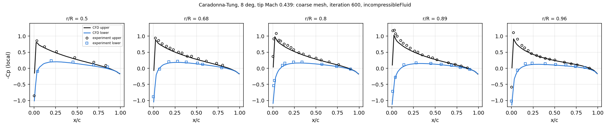
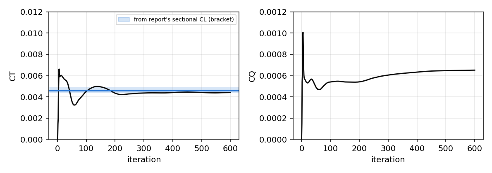

# Caradonna-Tung hover rotor, `coarse` mesh

Validation case for the 54x18 prop CFD method: 2 blades, NACA 0012, R = 1.143 m, c = 0.1905 m, 8 deg collective, tip Mach 0.439 (OpenFOAM 13, incompressibleFluid, MRF, k-omega SST, 10 cores, 600 iterations).
Baseline mesh: 3.1 mm blade cells, 1.6 mm on the sharp edges only (the leading edge stayed at 3.1 mm). 1,503,816 cells, layer coverage 93 %, mean y+ 41.

| Quantity | CFD | Reference | Difference |
|---|---|---|---|
| CT | 0.00440 | 0.00459 (experiment, from the report's sectional CL) | -4.2 % |
| CT | 0.00440 | 0.00602 (BEMT hand calc) | -26.9 % |
| Thrust T | 493.5 N | | |
| Torque Q | 83.2 N m | | |
| CQ | 0.000648 | | |
| Figure of merit | 0.318 | 0.318 (CT^1.5 / (sqrt 2 CQ), by hand) | |

Torque split: pressure 66.8 N m + viscous 16.4 N m (20 %) = 83.2 N m.
Check: the pvpython pressure-only surface integral (`ct_torque_split_coarse.json`) gives 67.1 N m against 66.8 N m from the solver (+0.5 %).

Convergence over the last 120 of 600 iterations: CT drift -0.42 %/100 it, CQ drift +0.73 %/100 it (converged means below 0.5): **torque not converged**.

| r/R | CN CFD | CL report | Difference | Suction peak CFD | Suction peak experiment |
|---|---|---|---|---|---|
| 0.5 | 0.211 | 0.234 | -10.1 % | 0.80 | 0.86 |
| 0.68 | 0.238 | 0.281 | -15.5 % | 0.88 | 0.94 |
| 0.8 | 0.267 | 0.289 | -7.3 % | 0.98 | 1.09 |
| 0.89 | 0.278 | 0.314 | -11.6 % | 1.03 | 1.18 |
| 0.96 | 0.256 | 0.268 | -4.5 % | 0.92 | 1.12 |

## Takeaways

- Torque was still rising at 600 iterations (CQ drift +0.73 %/100 it), so 83 N m is a lower bound for this mesh.
- Diagnosis: the leading-edge cells (3.1 mm) were as big as the nose radius (3.0 mm), so the suction peak that pulls the blade forward was under-resolved and showed up as extra pressure torque.

Files: `ct_cfd_*.json` (full summary), `force_history.csv` (CT, CQ every 10 iterations), `ct_torque_split_*.json` (radial bands), `ct_case_*.json` (mesh recipe), `ct_guard_*.json` (runaway-guard limits). Regenerate with `python3 src/ct_validation.py post coarse` then `python3 src/ct_export.py coarse` in `Props/01_54x18_Composite/`.
