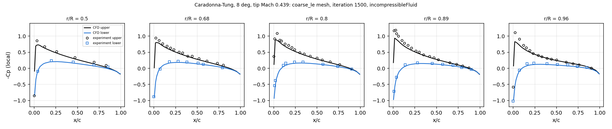
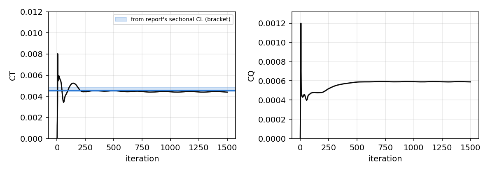

# Caradonna-Tung hover rotor, `coarse_le` mesh

Validation case for the 54x18 prop CFD method: 2 blades, NACA 0012, R = 1.143 m, c = 0.1905 m, 8 deg collective, tip Mach 0.439 (OpenFOAM 13, incompressibleFluid, MRF, k-omega SST, 10 cores, 1500 iterations).
Leading-edge mesh: coarse + a level-9 tube (0.78 mm cells) along each leading edge, to recover the leading-edge suction. 2,450,493 cells, layer coverage 95 %, mean y+ 41.

| Quantity | CFD | Reference | Difference |
|---|---|---|---|
| CT | 0.00443 | 0.00459 (experiment, from the report's sectional CL) | -3.5 % |
| CT | 0.00443 | 0.00602 (BEMT hand calc) | -26.3 % |
| Thrust T | 497.1 N | | |
| Torque Q | 75.8 N m | | |
| CQ | 0.000591 | | |
| Figure of merit | 0.353 | 0.353 (CT^1.5 / (sqrt 2 CQ), by hand) | |

Torque split: pressure 58.4 N m + viscous 17.4 N m (23 %) = 75.8 N m.
Check: the pvpython pressure-only surface integral (`ct_torque_split_coarse_le.json`) gives 58.3 N m against 58.4 N m from the solver (-0.3 %).

Convergence over the last 300 of 1500 iterations: CT drift -0.49 %/100 it, CQ drift -0.13 %/100 it (converged means below 0.5): **torque converged**.

| r/R | CN CFD | CL report | Difference | Suction peak CFD | Suction peak experiment |
|---|---|---|---|---|---|
| 0.5 | 0.207 | 0.234 | -11.9 % | 0.73 | 0.86 |
| 0.68 | 0.240 | 0.281 | -14.6 % | 0.80 | 0.94 |
| 0.8 | 0.270 | 0.289 | -6.5 % | 0.89 | 1.09 |
| 0.89 | 0.279 | 0.314 | -11.2 % | 0.94 | 1.18 |
| 0.96 | 0.256 | 0.268 | -4.5 % | 0.83 | 1.12 |

## Takeaways

- Refining only the leading edge cut torque by 7.4 N m (83.2 -> 75.8, -9 %) with thrust unchanged (+0.7 %), and the figure of merit rose from 0.318 to 0.353. The whole change is pressure torque (66.8 -> 58.4 N m); friction torque rose slightly (16.4 -> 17.4 N m).
- It is not the whole gap: the torque-split script estimates another ~11 N m of pressure torque would go if the sections carried the leading-edge suction of an attached NACA 0012 at their CFD normal force (that would give ~65 N m, near the 60-65 N m expected). The next step is a finer leading edge or finer blade surface overall (the medium mesh), not more iterations: this run is converged (CQ drift -0.13 %/100 it).
- Open question: the section suction peaks below read lower than on coarse (e.g. 0.89 vs 0.98 at r/R 0.8, experiment 1.09), even though total pressure torque fell. The Cp sections are averaged in 80 chordwise bins (2.4 mm) over a 4.7 mm radial band on both meshes, so the binning alone does not explain it. Check the raw face values at the nose before trusting either mesh's peak.

Files: `ct_cfd_*.json` (full summary), `force_history.csv` (CT, CQ every 10 iterations), `ct_torque_split_*.json` (radial bands), `ct_case_*.json` (mesh recipe), `ct_guard_*.json` (runaway-guard limits). Regenerate with `python3 src/ct_validation.py post coarse_le` then `python3 src/ct_export.py coarse_le` in `Props/01_54x18_Composite/`.
