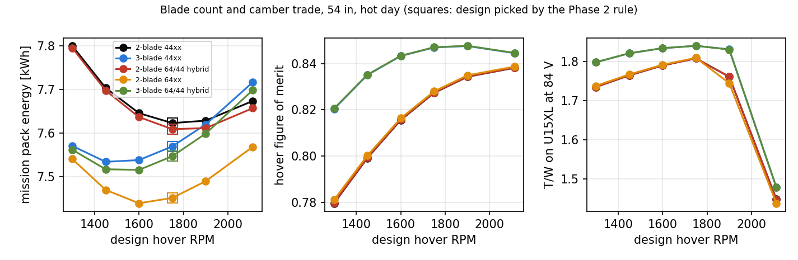

# Blade-count and camber trade at 54″

Generated by `make_blade_trade_report.py` from `results/blade_trade.json` (`src/blade_trade_study.py`). Do not edit by hand.

Question: does a 3-blade rotor or a more cambered section (NACA 64xx) make the 54″ prop more efficient for the mission?

## Answer

- **No option saves more than 2.4 % of mission energy.** The Phase 2 blade is close to the best this method can find at 54″, as expected:
  hover power is 91 % induced, and induced power is set by disk area, not by blade shape.

- **64xx inboard only (the hybrid): -0.2 %.** Too small to matter. The inboard 40 % of the span carries little thrust.

- **64xx full span: -2.3 % at the selected design, -2.4 % at its best RPM.** The gain is in cruise, not hover
  (hover FoM 0.827 → 0.828): more camber gives the same lift at a lower angle, so the most loaded
  outboard sections in cruise run at 7.5° instead of 9.5°, further inside the low-drag range. Payload gain
  +0.57 / +0.86 kg (303 / 200 Wh/kg). Costs not modelled here: a larger nose-down pitching moment (blade torsion) and
  an earlier stall at low Re.

- **3 blades: -0.7 % energy, FoM 0.827 → 0.847, T/W 1.81 → 1.84.** The battery saved
  is eaten by the extra blade: payload -0.14 / -0.05 kg before the heavier 3-blade hub. **The real gain is vibration:** the hub roll-moment
  ripple in cruise drops from ±48 N·m at 2P to ±5 N·m at 3P, and the thrust ripple from ±26 N to ±2 N.
  Each blade also carries less: ±88 N 1P on 139 N instead of ±119 N on 208 N.

- **Recommendation.** Not worth changing the blade for efficiency. A full-span 6 % camber section is the only option with a
  clear energy gain, and it is within the error of the method; revisit it if CFD shows the cruise profile drag matters.
  Keep 3 blades in mind as a **fatigue and vibration** fix for Phase 5, not as an efficiency fix.

## Method

Each case repeats the Phase 2 hover design (minimum-induced-loss blade, chord cap 0.22 R, root shank, re-twist to the design cl), across
the same design-RPM sweep, with the same selection rule: **largest T/W on the U15XL at 84 V among designs with ≥ 4° stall margin that
reach T/W 2.0 inside the tip-Mach limit**. No two-point refinement, so the baseline is the *unrefined* Phase 2 blade
(7623 Wh, regression check against Phase 2's sweep). The refined final blade was 1.9 % better than that and every case here would gain similarly.

NACA 64xx polars were run in XFOIL on the same grid as the 44xx (4 thicknesses × 5 Re × 4 Mach); 7 cases did not converge and were filled from the nearest lower Mach number. The hybrid blade blends the two families by thickness:
6 % camber where t/c ≥ 15 % (inboard of about 0.43 R), 4 % where t/c ≤ 12 % (outboard of 0.60 R), linear in between.

Hub ripple is built by adding the azimuthal loads of N equally spaced blades. For a rigid N-blade rotor every harmonic that is not a
multiple of N cancels at the hub, so a 2-blade rotor passes the large 1P blade load through as a 2P hub load, and a 3-blade rotor only passes
the much smaller 2P/3P content.

## Results (design picked by the selection rule)

| Quantity | 2-blade 44xx | 3-blade 44xx | 2-blade 64/44 hybrid | 2-blade 64xx | 3-blade 64/44 hybrid |
|---|---|---|---|---|---|
| Design hover RPM (sweep point) | 1750 | 1750 | 1750 | 1750 | 1750 |
| Solidity | 0.104 | 0.127 | 0.104 | 0.104 | 0.127 |
| Equivalent pitch at 75 % R [in] | 27.4 | 27.0 | 27.4 | 22.8 | 27.0 |
| Hover FoM | 0.827 | 0.847 | 0.827 | 0.828 | 0.847 |
| Hover shaft power [W]: induced / profile | 5156 / 491 | 4968 / 548 | 5155 / 491 | 5155 / 488 | 4967 / 548 |
| Thrust-weighted section cd in hover | 0.0097 | 0.0111 | 0.0097 | 0.0096 | 0.0111 |
| Cruise shaft power at 15 m/s, total [W] | 12620 | 12577 | 12592 | 12271 | 12531 |
| Max outboard α in cruise at 15 m/s [°] | 9.5 | 11.0 | 9.3 | 7.5 | 9.2 |
| **Mission pack energy [Wh]** | **7623** (+0.0 %) | **7569** (-0.7 %) | **7609** (-0.2 %) | **7451** (-2.3 %) | **7547** (-1.0 %) |
| T/W on U15XL at 84 V / fresh pack | 1.81 / 1.98 | 1.84 / 2.01 | 1.81 / 1.98 | 1.81 / 1.98 | 1.84 / 2.01 |
| Stall margin in hover [°] | 6.5 | 6.3 | 6.5 | 6.6 | 6.3 |
| Blade-set volume per rotor [cm³] | 1969 | 2189 | 1969 | 1969 | 2189 |
| Blade-set mass per rotor, scaled from vendor [g] | 940 | 1045 | 940 | 940 | 1045 |
| Blade thrust at 15 m/s: mean ± 1P [N] | 208 ± 119 | 139 ± 88 | 208 ± 120 | 208 ± 123 | 139 ± 90 |
| Hub roll moment at 15 m/s: mean ± ripple [N·m] (ripple freq.) | 45 ± 48.5 (2P) | 47 ± 5.1 (3P) | 45 ± 48.8 (2P) | 46 ± 50.6 (2P) | 47 ± 5.2 (3P) |
| Hub thrust ripple at 15 m/s [N] | ± 26.3 | ± 2.2 | ± 26.5 | ± 23.9 | ± 2.2 |

## Results (lowest-energy design in each sweep)

| Quantity | 2-blade 44xx | 3-blade 44xx | 2-blade 64/44 hybrid | 2-blade 64xx | 3-blade 64/44 hybrid |
|---|---|---|---|---|---|
| Design hover RPM (sweep point) | 1750 | 1450 | 1750 | 1600 | 1600 |
| Solidity | 0.104 | 0.156 | 0.104 | 0.110 | 0.141 |
| Equivalent pitch at 75 % R [in] | 27.4 | 31.3 | 27.4 | 24.9 | 28.9 |
| Hover FoM | 0.827 | 0.835 | 0.827 | 0.816 | 0.843 |
| Hover shaft power [W]: induced / profile | 5156 / 491 | 5087 / 508 | 5155 / 491 | 5249 / 474 | 5015 / 525 |
| Thrust-weighted section cd in hover | 0.0097 | 0.0103 | 0.0097 | 0.0094 | 0.0107 |
| Cruise shaft power at 15 m/s, total [W] | 12620 | 12465 | 12592 | 12205 | 12454 |
| Max outboard α in cruise at 15 m/s [°] | 9.5 | 10.3 | 9.3 | 7.6 | 9.2 |
| **Mission pack energy [Wh]** | **7623** (+0.0 %) | **7534** (-1.2 %) | **7609** (-0.2 %) | **7439** (-2.4 %) | **7515** (-1.4 %) |
| T/W on U15XL at 84 V / fresh pack | 1.81 / 1.98 | 1.82 / 1.99 | 1.81 / 1.98 | 1.79 / 1.96 | 1.83 / 2.00 |
| Stall margin in hover [°] | 6.5 | 6.9 | 6.5 | 7.0 | 6.5 |
| Blade-set volume per rotor [cm³] | 1969 | 2944 | 1969 | 2135 | 2563 |
| Blade-set mass per rotor, scaled from vendor [g] | 940 | 1405 | 940 | 1019 | 1224 |
| Blade thrust at 15 m/s: mean ± 1P [N] | 208 ± 119 | 139 ± 98 | 208 ± 120 | 208 ± 127 | 139 ± 95 |
| Hub roll moment at 15 m/s: mean ± ripple [N·m] (ripple freq.) | 45 ± 48.5 (2P) | 56 ± 6.6 (3P) | 45 ± 48.8 (2P) | 49 ± 53.8 (2P) | 52 ± 6.0 (3P) |
| Hub thrust ripple at 15 m/s [N] | ± 26.3 | ± 3.2 | ± 26.5 | ± 25.9 | ± 2.7 |

## Hand calculation vs BEMT

**Tip loss, 2 → 3 blades.** Prandtl's tip loss shrinks the working disk to an effective radius B R with B ≈ 1 − √(2 C_T) / N.
With C_T = T / (ρ A (ΩR)²) = 0.0148: B₂ = 0.914, B₃ = 0.943. Induced power goes as 1/B,
so 3 blades should need 3.0 % less induced power.

**Profile power.** P₀ = ρ A (ΩR)³ σ c_d0 / 8, with c_d0 the BEMT's thrust-weighted section drag.

| Quantity | Hand calc | BEMT | Diff |
|---|---|---|---|
| Induced power cut, 2 → 3 blades [%] | 3.0 | 3.6 | +0.6 points |
| Profile power, 2 blades [W] | 461 | 491 | +6 % |
| Profile power, 3 blades [W] | 587 | 548 | -7 % |

Both agree within 10 %. The hand profile formula assumes constant chord and uniform inflow; the BEMT blade is tapered. The 3-blade rotor's
sections run at lower Reynolds number (narrower chord), which is why its c_d0 rises from 0.0097 to 0.0111
and its profile power rises while its induced power falls. The net is the small FoM gain.

## Caveats

- Same BEMT limits as Phase 2: clean-surface XFOIL drag, no compressibility drag rise, rigid-blade forward flight with prescribed inflow.
  The Caradonna–Tung check showed BEMT over-predicting thrust by about 31 % on that rotor, so read these as **relative** differences.
- 64xx at high cl and low Re is where XFOIL is least reliable, and that is where its cruise gain comes from.
- Blade mass scales the vendor's 2-blade mass by volume; a 3-blade hub (heavier, harder to balance and fold) is not included.
- No case was given the two-point refinement; it adds about 2 % to each roughly equally.
