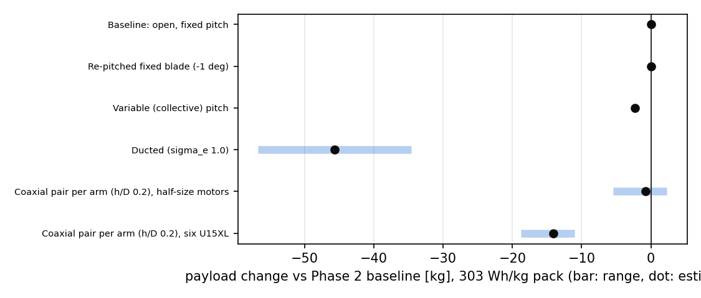
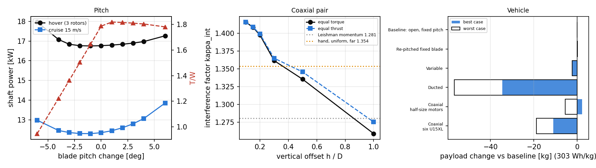

# Configuration study: pitch, duct and coaxial (Phase 5.0)

Generated by `make_config_report.py` from `results/config_study.json` (`src/config_study.py`). Do not edit by hand.

Question: should the 280 lb tricopter change its rotor configuration? Four options against the Phase 2 baseline (open rotor, fixed pitch, 2 blades, one per arm), all on the same blade, polars, hot-day atmosphere and 10 nmi mission as Phase 2.

## Answer

- **Pitch: no.** The Phase 2 blade already sits at the bottom of the power curve. The best fixed setting (-1°) saves 0.3 % of mission energy but drops T/W from 1.79 to 1.65. Variable pitch, re-set in every segment (hover -1.0°, climb -0.7°, cruise -1.4°), saves 0.3 % and raises T/W only to 1.82, because the motor is current-limited, not RPM-limited. The 2.4 kg of pitch hubs and servos then cost 2.3 kg of payload. Its real value is control speed, which this study does not price (see Pitch).
- **Duct: no, decisively.** In hover a duct cuts power by 35 %, which is what momentum theory promises. But this mission is 82 % cruise by energy, and in cruise each duct has to turn about 391 N of incoming air (momentum drag, about the same as its thrust). Cruise power rises 2–3×, the pack grows 84–174 %, and the three ducts weigh about 14 kg. Payload loss: 35–57 kg.
- **Coaxial pair per arm: payload-neutral, but it buys range, yaw balance and (with full-size motors) motor-out survival.** In hover the pair at h = 0.2 D uses only 1.6 % less power than one rotor, because interference eats almost all of the second rotor's benefit. Cruise is different: two disks per arm work on more air, so the estimate is -25 % cruise power and -20 % pack energy (range -32 to -1 %). Prandtl's biplane factor gives nearly the same cruise power (9.5 kW vs 9.3 kW). But a 20 % smaller pack is only 5.0 kg of battery, and half-size motors add 5.7 kg, so payload changes by -0.8 kg (range -5 to +2). What it does buy: about 25 % more cruise range on the same pack (estimate), balanced yaw torque on every arm (no tilt servo), and, with six U15XLs (-14 kg payload), survival of a motor failure in hover: one U15XL lifts a whole arm at T/W 1.79. A half-size motor cannot (0.89).
- **Recommendation.** Keep the Phase 2 rotor (open, fixed pitch) for payload. Pitch and duct are closed. The coaxial arm is the one configuration change worth carrying forward, and it should be picked for range margin and redundancy, not payload. Before committing: redesign the blade for half the thrust per rotor (this study reuses the Phase 2 blade off-design), decide whether motor-out survival is a requirement, which sets half-size against full-size motors, and confirm the cruise interference with CFD (coaxial MRF case at μ ≈ 0.17), since the benefit rests on a wake model.

## Baseline (regression check)

Hover 16764 W, climb 18576 W, cruise 12348 W (3 rotors, shaft), mission pack **7475 Wh**, the same as the Phase 2 final blade (7475 Wh). Hover, descent and climb carry 18 % of the energy and cruise 82 %: that split decides most of this study.

## 1–2. Pitch

A constant d_theta is added to the whole blade's twist (the rotor still trims thrust with RPM). Fixed pitch keeps one d_theta for the whole mission. Variable pitch picks the best d_theta in each segment: a parabola fitted through the grid minimum and its neighbours. Settings that leave less than 4° hover stall margin, or less than 1° anywhere on the azimuth in cruise, are not allowed.

| d_theta [°] | Hover [W] | Cruise [W] | Pack [Wh] | T/W (U15XL, 84 V) | Hover stall margin [°] | Cruise stall margin [°] |
|---|---|---|---|---|---|---|
| -6 | 17964 | 12982 | 7885 | 0.95 | 10.6 | 8.2 |
| -4 | 17078 | 12460 | 7557 | 1.22 | 10.3 | 7.0 |
| -3 | 16839 | 12356 | 7486 | 1.36 | 9.9 | 6.3 |
| -2 | 16763 | 12305 | 7454 | 1.50 | 9.5 | 5.6 |
| -1 | 16752 | 12300 | 7451 | 1.65 | 9.0 | 4.9 |
| +0 | 16764 | 12348 | 7475 | 1.79 | 8.5 | 4.1 |
| +1 | 16794 | 12447 | 7526 | 1.82 | 7.9 | 3.3 |
| +2 | 16838 | 12598 | 7603 | 1.82 | 7.3 | 2.5 |
| +3 | 16895 | 12801 | 7707 | 1.81 | 6.6 | 1.7 |
| +4 | 16974 | 13065 | 7842 | 1.80 | 5.9 | 0.8 |
| +6 | 17265 | 13853 | 8250 | 1.78 | 4.4 | -1.0 |

Why so little: the Phase 2 blade was already optimised for this mission (two-point refinement over hover and cruise). A fixed-pitch rotor moves its operating point with RPM, which keeps the sections near their design lift coefficient, so pitch only buys the last ~1°. Pitching up does not raise T/W either: above 0° the U15XL hits its 180 A current limit before its RPM limit, and more pitch only makes each RPM cost more torque.

**Control speed (hand calculation, not priced above).** Rotor inertia I ≈ 2 m R²/4 = 0.111 kg·m² (2 blades of 0.47 kg, tapered). Spare torque at hover = K_t I_peak − Q_hover = 0.251 × 180 − 27.6 = 17.6 N·m (K_t = 60 / (2π KV)). +20 % thrust needs +9.5 % RPM (T ∝ Ω²), so Δt = I ΔΩ / ΔQ = 121 ms. That is quick for a large rotor, because the blades are light for their size. A pitch servo is still faster (~10–20 ms for a few degrees), and it can also give negative thrust. That matters for attitude authority in gusts, not for energy, so variable pitch is a controls question for later, not an efficiency one.

## 3. Duct

Momentum theory for a ducted rotor (disk area A, exit area σ_e A, disk velocity v_d):

    T = ρ A v_d (v_d / σ_e)          →  v_d = √(σ_e T / (ρ A))
    T_rotor / T = 1 / (2 σ_e)         (the inlet lip carries the rest by suction)
    P_ideal = T^1.5 / √(4 σ_e ρ A)   vs  T^1.5 / √(2 ρ A) open  →  ratio 1 / √(2 σ_e) = 0.707 at σ_e = 1

Hand check at the hover thrust 415 N per rotor: v_d = √(415 / (1.109 × 1.478)) = 15.91 m/s (code 15.91); open-rotor ideal 14015 W for 3 rotors, ducted ideal 9910 W (code 9910). The blade elements, run with v_d prescribed and no tip loss, need 10897 W (91 % of the ducted ideal), against 16764 W open: **-35 %**. Keeping the open-rotor tip loss (a large tip gap) costs only 73 W. A short diffuser (σ_e 1.1) gives 10464 W. Real ducts lose some of this to inlet-lip separation, the diffuser and the tip gap, so the hover number is the upper bound of the benefit.

**Cruise is where the duct loses.** Air reaches the duct horizontally at V and leaves along the duct axis, so the duct must remove its horizontal momentum: momentum drag D = ṁ V = ρ A v_d V = 1.109 × 1.478 × 15.91 × 15 = 391 N per duct (code 391), about equal to its thrust. Add the ring's side drag (35 N, C_D 0.6 on D × L) and the vehicle has to tilt far forward and push 1355 N of drag instead of 75 N. Bounds: induced power and disk velocity as in hover (pessimistic, 39.9 kW), or dropping by the open rotor's own hover-to-cruise ratio (0.69, optimistic, 26.2 kW), against 12.3 kW open. Even the optimistic bound doubles cruise power.

Mass: a ring of length 0.25 D = 0.34 m, two skins at 1.2 kg/m², plus 30 % for lip, stators and mounts: 2π D L × 1.2 × 1.3 = 4.6 kg each.

A duct pays on a mission that is mostly hover (inspection, lifting at a site), not on a 10 nmi delivery run.

## 4. Coaxial pair per arm (dual vertical offset)

Two counter-rotating copies of the Phase 2 blade on each arm, offset vertically by h. Each wake is a semi-infinite vortex cylinder, which induces on its axis at distance z downstream (+) or upstream (−) of its disk:

    w(z) = v_i (1 + z / √(R² + z²))        w(−z) = v_i (1 − z / √(R² + z²))
    slipstream radius by continuity:  r_w = R √(v_i / w(z))   → R / √2 far downstream

The lower rotor runs the Phase 2 BEMT with w(h) as extra inflow inside r_w and none outside. The upper rotor runs it with the lower rotor's upstream induction. Both are iterated to convergence and trimmed to the arm's thrust with **equal torque** (yaw balance).

Interference factor κ_int = (induced + interference power of the pair) / (2 × induced power of one isolated rotor at T/2):

| h / D | κ_int (equal torque) | κ_int (equal thrust) | Upper thrust share | RPM upper / lower | Arm hover power vs one rotor |
|---|---|---|---|---|---|
| 0.1 | 1.416 | 1.416 | 0.518 | 1538 / 1585 | -0.5 % |
| 0.15 | 1.408 | 1.409 | 0.526 | 1528 / 1601 | -0.9 % |
| 0.2 | 1.397 | 1.399 | 0.532 | 1519 / 1616 | -1.6 % |
| 0.3 | 1.361 | 1.365 | 0.535 | 1500 / 1631 | -3.7 % |
| 0.5 | 1.335 | 1.346 | 0.547 | 1482 / 1672 | -4.9 % |
| 1.0 | 1.259 | 1.276 | 0.543 | 1448 / 1690 | -9.6 % |

Hand checks. (1) At h → 0 the two disks merge into one carrying twice the thrust, so κ_int → 2^1.5 / 2 = √2 = 1.414 (code at h/D 0.1: 1.416). (2) Far downstream the slipstream radius is R/√2 = 0.7071 R (code 0.7073 R). (3) Uniform loading, far spacing, equal thrust: the upper rotor is isolated (P = T v_h). The inner half of the lower rotor sees 2 v_h, so 2ρ(2v_h + v)v = 2ρ v_h² → v = (√2 − 1) v_h, and its outer half has v = v_h. Then κ_int = [1 + (1 + √2 + 1)/2] / 2 = 1.354. The BEMT gives 1.269, lower because the real blade carries most of its thrust outboard of 0.71 R, outside the upper wake. Leishman's momentum value is 1.2808 (different lower-wake assumption), and measured coaxial rotors fall in 1.16–1.3.

So in hover the second rotor on each arm buys little: 1.6 % at h/D 0.2, rising to 10 % at h/D 1.0 (a 1.4 m mast). The pair's blades also run at half load, below their design lift coefficient. A blade designed for the pair would do better.

**Cruise.** Edgewise induced power goes as T² / (2 ρ A V), so it depends on how much fresh air each disk gets. Two isolated disks at T/2 would need half of one disk's induced power. The upper wake skews back at χ = atan(μ/λ) = 68° from the shaft axis, so at the lower disk it has moved d = h tan χ = 0.69 m aft, and covers a fraction f = 0.39 of the lower disk (overlap of two circles of radius R at centre distance d). The estimate blends one-disk and isolated induced power by f: 9.3 kW for the vehicle, between 7.4 kW (isolated) and 12.2 kW (one disk), against 12.3 kW open.

Independent check (Prandtl biplane). A rotor in edgewise flight acts like a circular wing of span D, so a coaxial pair is a biplane with gap/span G/b = 0.2. Prandtl's interference factor σ = (1 − 0.66 G/b) / (1.055 + 3.7 G/b) = 0.484, and for equal loads the pair's induced drag is (1 + σ)/2 = 0.742 of one wing carrying both. The overlap model gives 0.723. Vehicle cruise power by the biplane factor: 9.51 kW, against 9.31 kW.

Mass per arm: single rotor 6.52 kg (U15XL 4.408 kg + ESC + props + hub). A coaxial pair with half-power motors (0.5 × U15XL × 1.15 for the smaller motor's lower power density) is 8.59 kg. Cross-check: the Hobbywing H13 coaxial pair is 8.01 kg per arm with props, rated 45 kgf, max 113 kgf (our arm needs 42 kgf hover, 85 kgf at T/W 2). Removing the tricopter's yaw tilt mechanism saves an assumed 0.5 kg.

Motor-out: if one rotor of a pair fails, the other must lift the arm alone and the remaining arms trim the yaw. A full U15XL reaches T/W 1.79 on the arm's hover thrust, so it can. A half-size motor reaches 0.89, so it cannot.

## Vehicle summary

| Configuration | Pack energy [Wh] (range) | vs baseline | Added hardware [kg] | Payload change [kg] at 303 Wh/kg (range) | Note |
|---|---|---|---|---|---|
| Baseline: open, fixed pitch | 7475 | +0.0 % | 0.0 | -0.0 | Phase 2 design |
| Re-pitched fixed blade (-1 deg) | 7451 | -0.3 % | 0.0 | +0.1 | one new blade setting |
| Variable (collective) pitch | 7449 | -0.3 % | 2.4 | -2.3 | pitch hub + servo per rotor |
| Ducted (sigma_e 1.0) | 17129 (13776–20481) | +129.2 % | 13.8 | -45.7 (-56.7 to -34.6) | duct shell, lip and struts |
| Coaxial pair per arm (h/D 0.2), half-size motors | 5969 (5050–7400) | -20.1 % | 5.7 | -0.8 (-5.5 to +2.3) | 3 more motors, ESCs, props; no yaw tilt servo |
| Coaxial pair per arm (h/D 0.2), six U15XL | 5969 (5050–7400) | -20.1 % | 19.1 | -14.1 (-18.8 to -11.1) | motor-out tolerant at hover |

Payload change = −(added hardware + extra pack energy / pack specific energy), at fixed 280 lb MTOW (the Phase 1 decision).

## Limits

- The duct and coaxial cruise numbers come from simple wake models, bracketed rather than solved. Nothing here has been checked by CFD, and the Caradonna–Tung validation shows the CFD method still over-predicts torque by about 20 %.
- The coaxial study reuses the Phase 2 blade at half load. A blade redesigned for the pair (lower solidity or lower RPM) is the next step.
- The masses for pitch hubs, ducts and half-size motors are assumptions, listed in `params.yaml` under `config_study` with their sensitivities.
- Coaxial spacing also changes the frame (mast height, landing-gear clearance, the lower rotor's ground effect). None of that is modelled.

Regenerate: `python3 src/config_study.py` (about 3 minutes, one core), then `python3 make_config_report.py`.
