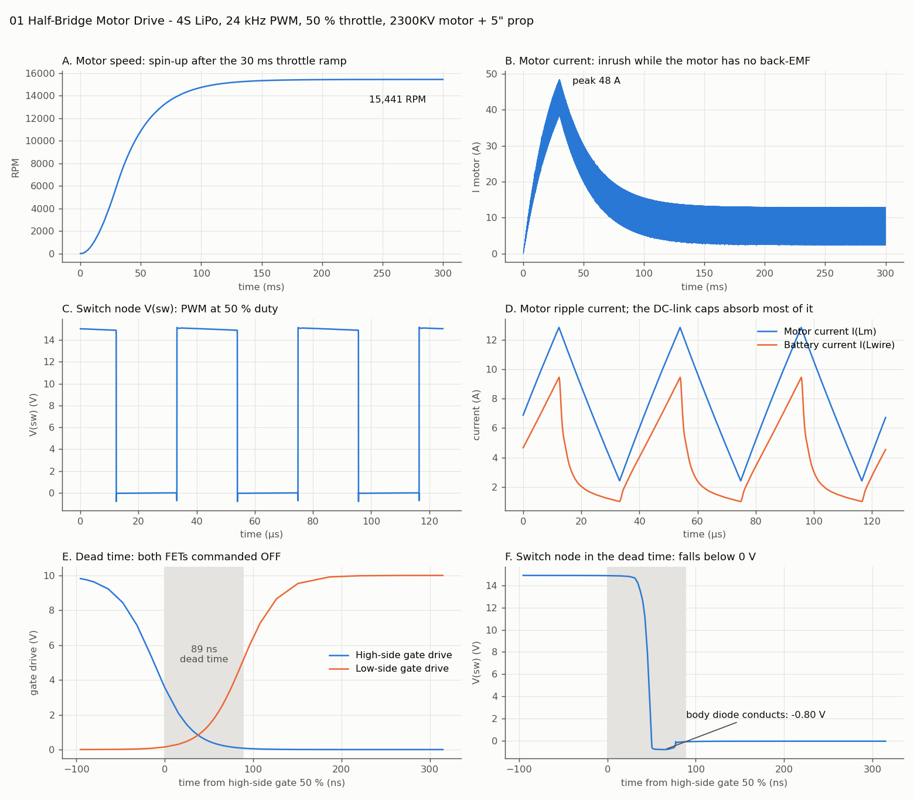

# 01 — Half-Bridge Motor Drive

**Topology type:** Half-bridge, also called a synchronous buck or one ESC phase leg
**File:** `HalfBridge_MotorDrive.asc`
**Why start here:** A drone ESC is three of these half-bridges sharing one DC bus. Every idea
used later (PWM, dead time, freewheeling, DC-link ripple, switching loss) already shows up in one leg.

```
 4S LiPo        wiring        DC link          half-bridge          motor (one equivalent phase)
 Vbat ─ Rint ─── Lwire ──┬── bus ──────┬── Mhi (high side) ─┐
                         │             │                   ├── sw ── Lm ── Rm ── B_EMF (=Ke·ω) ─ GND
                     Cbulk ║ Cceram    └── Mlo (low side) ──┘
                         │                    │
 GND ────────────────────┴────────────────────┘
```

## What each block models

| Block | Part | Value | Why it's there |
|---|---|---|---|
| Battery | `Vbat`, `Rint` | 15.2 V, 20 mΩ | 4S LiPo at 3.8 V/cell. Rint is why the voltage sags under load |
| Wiring | `Lwire` | 100 nH + 2 mΩ | Battery leads. This inductance is why an ESC needs local caps |
| DC link | `Cbulk` 470 µF (30 mΩ ESR), `Cceram` 10 µF | | Supplies the chopped current so the battery leads don't have to |
| Switches | `Mhi`, `Mlo` → `ESC_FET` | VDMOS, about 3 mΩ, 30 V | Custom model in the schematic. Edit its parameters and see what changes |
| Gate drive | `B_GH`, `B_GL` + `Rg` 4.7 Ω | 10 V | Ideal floating drivers. A real ESC uses a bootstrap supply for the high side (a later topic) |
| Motor | `Lm` 15 µH, `Rm` 0.1 Ω, `B_EMF` | 2300 KV | Electrical equivalent of a 2205-class motor |
| Mechanics | `C_J`, `B_Tmotor`, `B_Tprop` | J = 5e-6 kg·m², T_prop = k·ω² | Mechanics modeled as a circuit (see below) |

### Technique: mechanics as a circuit
SPICE only solves circuits, so the rotor is mapped onto circuit elements:

| Mechanical | Electrical analog |
|---|---|
| speed ω (rad/s) | voltage `V(omega)` |
| torque (N·m) | current |
| inertia J | capacitor `C_J` (I = C·dV/dt ⇔ T = J·dω/dt) |
| motor torque Kt·I | current source `B_Tmotor` |
| prop drag k·ω² | current sink `B_Tprop` |

For a DC motor, Kt (N·m/A) equals Ke (V·s/rad), and both are 60/(2π·KV).

### Technique: PWM with dead time
A 24 kHz triangle `V(tri)` is compared with the throttle `V(duty)`:
- The high-side FET is ON when `tri < duty − db`.
- The low-side FET is ON when `tri > duty + db`.

The band of ±db is the **dead time**: both FETs are off, so the supply can never be shorted through
both FETs at once (shoot-through). Because the band is 2·db wide, `db = Tdead/Tsw` gives the
requested Tdead. I first wrote `Tdead/(Tsw/2)`, which doubled the dead time; panel E of the plot
exposed the error.

## Results (50 % throttle, steady state 280–300 ms)

| Quantity | Simulated | Hand check |
|---|---|---|
| Speed | 15,440 RPM | Solves Vbus·D = I·R + Ke·ω |
| Motor current (avg) | 7.64 A | |
| Battery current (avg) | 3.88 A | ≈ D · I_motor = 3.82 A ✔ (a buck steps current *up*) |
| Motor ripple (p-p) | 10.5 A | ΔI = V·D(1−D)/(L·f) = 15.1·0.25/(15µ·24k) = 10.5 A ✔ |
| Startup peak current | 48 A | No back-EMF at standstill, so only R and L limit current |
| DC-bus ripple (p-p) | 0.46 V | |
| Input power / mechanical power | 58.6 W / 51.3 W | **87.6 % efficient** |
| Copper loss | 6.7 W | Includes ripple: I²rms = Iavg² + ΔI²/12 |
| FET losses (hi / lo) | 0.20 W / 0.11 W | The FETs are *not* where the power goes |



## Lessons from this run
1. **The motor is the filter.** The switch node is a 0/15 V square wave (panel C), yet the current is a
   triangle (panel D). The winding inductance does the smoothing. Low-inductance racing motors
   therefore need higher PWM frequencies (48–96 kHz).
2. **Ripple costs real power.** The 10.5 A of ripple adds about 1 W of copper heating that produces
   no thrust. Doubling Fsw halves the ripple.
3. **Back-EMF is the current limiter.** At standstill, 7.6 V across 0.1 Ω allows up to 76 A. Only the
   throttle ramp held the peak to 48 A. This is why ESC firmware has soft-start and current limiting.
4. **Dead time has a cost.** During the dead time, the motor current forces the low-side body diode to
   conduct, pulling the switch node to about −0.8 V (panel F). Doubling the dead time (the bug above)
   raised the low-FET loss by about 50 % (0.15 W → 0.23 W, measured in the earlier 150 ms run).
5. **Battery current ≠ motor current.** The battery supplies D·I_motor on average. The bulk caps
   supply the pulsed difference, which is why ESCs fail when their caps are undersized.

## Experiments to try
- `Duty=0.9`: full throttle. Watch RPM, current, and efficiency.
- `Fsw=48k`: ripple halves. Check whether copper loss drops and switching loss rises.
- `Tdead=500n`: watch the body-diode conduction time and `Pfet_lo`.
- Delete `Cbulk`: watch `Vbus_ripple` and the ringing on `bus`.
- `Rg=20`: slower edges and more switching loss in `Mhi`.

## Design document
`01_Half-Bridge_Motor_Drive_Design.pdf` has the full derivation with math, the hand-calculation vs. LTspice table and the plots. Rebuild it with `python3 make_design_doc.py`.

## How to run
- **GUI:** open the `.asc` and press Run. Probe `V(sw)`, `I(Lm)`, and `V(rpm)`.
  Ctrl+L shows the `.meas` results.
- **Batch:** `wine LTspice.exe -b HalfBridge_MotorDrive.asc`, then `python3 plot_results.py`.
  The script uses `../tools/ltraw.py` to read the `.raw` file.
