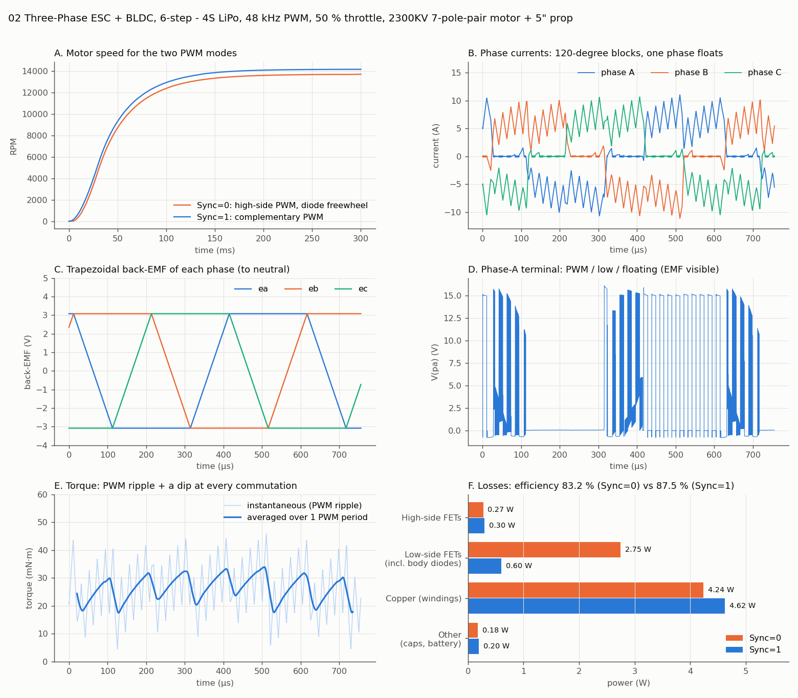

# 02 — Three-Phase ESC + BLDC (6-step trapezoidal)

**Topology type:** 3-phase inverter (3 half-bridge legs, 6 FETs) driving a wye-connected BLDC, Hall-sensored 6-step commutation
**Builds on:** [01 Half-Bridge](../01_Half-Bridge_Motor_Drive/README.md). Each leg here is that circuit.
**Design document (with all the math):** `02_Three-Phase_ESC_BLDC_6-Step_Design.pdf`

## Files
| File | What it is |
|---|---|
| `ThreePhase_ESC_BLDC.asc` | LTspice schematic. Open it and press Run (about 6 min; `.step` runs both PWM modes) |
| `gen_schematic.py` | Script that generated the schematic. Edit and rerun it to change the layout |
| `plot_results.py` | Builds `ThreePhase_ESC_BLDC_results.png` from the `.raw` file |
| `make_design_doc.py` | Builds the design PDF: hand calculations plus the LTspice `.meas` results |

## Techniques new in this design
- **Rotor angle by integration:** a 1 F capacitor charged by I = ω makes V(theta) = θm. Then θe = Pp·θm.
- **Trapezoidal back-EMF from one formula:** `trap(x) = limit(6/pi*asin(sin(x)), -1, 1)`, defined with `.func`.
- **Ideal Hall logic:** a phase drives HIGH when sin(θe − k·120°) > 0.5 and LOW when it is < −0.5.
- **Torque from power balance:** Te = Σ eₓiₓ / ω.
- **`.step param Sync list 0 1`:** compares high-side-only PWM (body-diode freewheel) against complementary PWM in one run.

## Results (50 % throttle, steady state 280–300 ms)
| | Sync=0 (diode freewheel) | Sync=1 (complementary) |
|---|---|---|
| Speed | 13,706 RPM | 14,178 RPM |
| Battery current | 2.93 A | 3.03 A |
| Low-side FET + diode loss | **2.75 W** | **0.60 W** |
| Efficiency | 83.2 % | 87.5 % |

## Lessons
1. In 6-step drive only two phases conduct, so the motor behaves like topology 01's DC motor: same R, L and Ke.
2. Yet it runs about 8 % slower than topology 01 at the same duty. Each commutation costs f_comm·L_ph·I ≈ 0.5 V
   of volt-seconds. The hand-vs-sim comparison found this; the first hand model, which left it out, was 9 % too fast.
3. Synchronous (complementary) PWM cuts low-side loss by about 4.6× (2.75 W → 0.60 W) because a FET drops ~27 mV where a diode drops ~0.8 V.
4. Torque has fast PWM ripple (about 41 mN·m p-p) plus slower commutation dips (about 16 mN·m p-p, 6 per electrical revolution) on 26 mN·m.
   Sinusoidal drive and FOC remove the dips.
5. A 7-pole-pair motor at 14.5k RPM commutates at about 10 kHz, so 48 kHz PWM gives only ~4.7 pulses per step.

## Experiments to try
- `Duty=0.9`: full throttle. Does the commutation loss grow?
- `Pp=6`: fewer pole pairs means fewer commutations per revolution.
- `Lph=15u`: more inductance means bigger commutation loss and smaller PWM ripple.
- `Fsw=24k`: count the PWM pulses per step in `V(pa)`.

**Note:** the `.raw` file is about 1.7 GB (two 300 ms runs). Delete it if you need the space. Running the simulation again recreates it.
