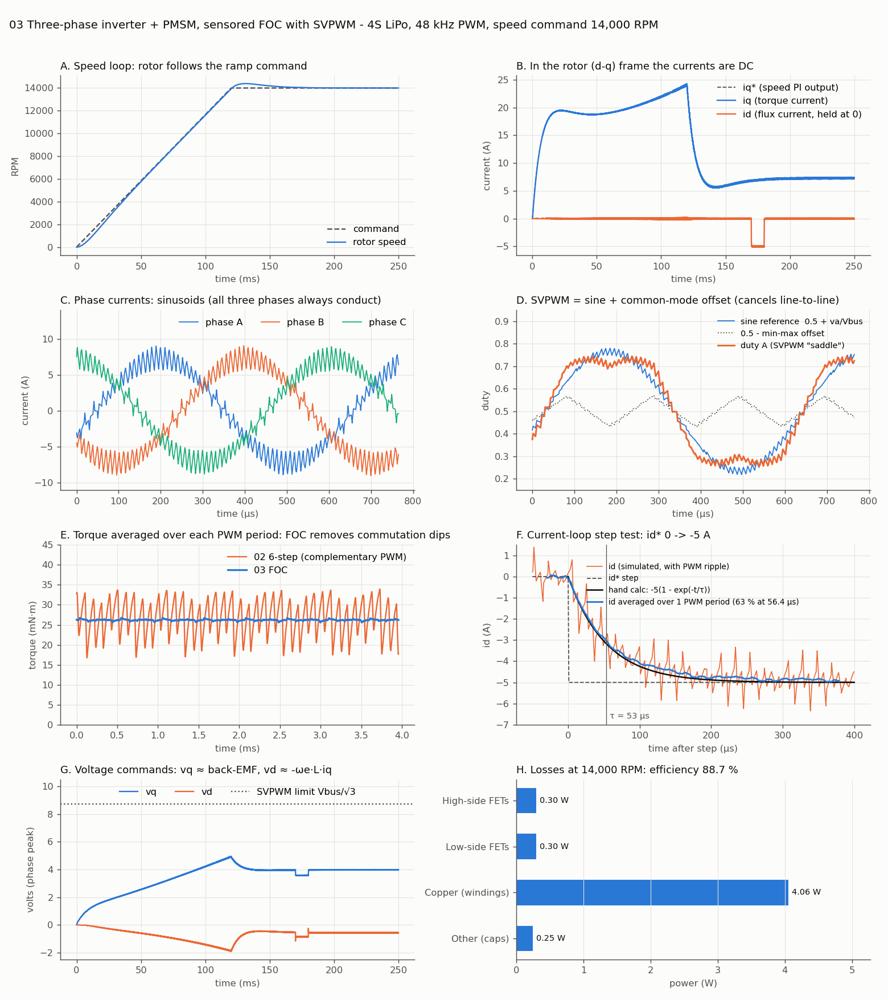

# 03 — Three-Phase FOC Drive (PMSM, sensored, SVPWM)

**Topology type:** 3-phase inverter (3 legs, 6 FETs, all complementary PWM) driving a sinusoidal-EMF PMSM under field-oriented control
**Builds on:** [02 Three-Phase ESC 6-step](../02_Three-Phase_ESC_BLDC_6-Step/README.md). Same power stage and motor R, L, KV and poles; only the control changes.
**Design document (with all the math):** `03_Three-Phase_FOC_PMSM_Design.pdf`

## Files
| File | What it is |
|---|---|
| `ThreePhase_FOC.asc` | LTspice schematic. Open it and press Run (about 4 min) |
| `gen_schematic.py` | Script that generated the schematic. Edit and rerun it to change the layout |
| `plot_results.py` | Builds `ThreePhase_FOC_results.png` and `torque_ripple.json` from the `.raw` file |
| `make_design_doc.py` | Builds the design PDF: hand calculations plus the LTspice `.meas` results |
| `ref_02_torque.npz` | Topology 02's PWM-averaged torque, saved for the comparison plot |

## Techniques new in this design
- **Clarke + Park transforms in B-sources:** the three phase currents become id and iq, which are DC in the rotor frame.
- **PI controllers with `idt()`:** `V = Kp*err + Ki*idt(err)` is a complete PI controller in one behavioral source.
- **Pole-zero cancellation tuning:** Kp = L·ωc, Ki = R·ωc gives a first-order current loop with τ = 1/ωc = 53 µs.
- **Decoupling feed-forward:** cancels ωe·L cross terms and the back-EMF so each PI sees a plain R-L.
- **Cascade control:** 30 Hz speed loop around 3 kHz current loops.
- **SVPWM by min-max injection:** one `max/min` expression gives Vbus/√3 instead of Vbus/2.
- **Built-in step test:** a −5 A id* pulse at 170 ms checks the current-loop tuning against the hand calculation.

## Results (speed command 14,000 RPM, steady state 230–250 ms)
| | Hand calc | LTspice |
|---|---|---|
| Speed | 14,000 RPM | 14,000 RPM |
| iq | 7.28 A | 7.28 A |
| vq / vd | 3.88 / −0.56 V | 3.98 / −0.58 V |
| Copper loss | 3.98 W | 4.06 W |
| Efficiency | 89.7 % (no switching loss) | 88.7 % |
| id step, time to 63 % | 53 µs | 56 µs |

Compared with 02 (6-step, complementary PWM) at about the same speed: PWM-averaged torque ripple drops from **16.5 to 1.2 mN·m**, and efficiency goes from 87.5 % to 88.7 %.

## Lessons
1. Sinusoidal EMF × sinusoidal current in phase = constant power, so torque has no commutation dips.
2. In the d-q frame the currents are DC, so ordinary PI loops regulate them with zero steady-state error.
3. vd is negative even with id = 0: the voltage must lead the current to drive it through L at 1.6 kHz.
4. vq came out 0.1 V above the ideal value. The PI loop silently makes up the FET drop and the dead-time error, (4/π)·Tdead·fsw·Vbus ≈ 93 mV.
5. Copper loss for the same torque equals ideal 6-step. FOC's advantage is smoothness and control, not copper efficiency.

## Experiments to try
- `Svm=0`: plain sine PWM. Then raise `RPMref` toward 30,000 and watch the duty clip before SVPWM would.
- `Dec=0`: turn off decoupling and watch id react during the speed ramp.
- `Fci=8k`: faster current loop. When does the PWM ripple start to chatter the comparator?
- `Tdur=60m`: hold id* = −5 A for 60 ms. Torque barely changes, because id makes no torque in this motor. Negative id at high speed is the basis of field weakening.

**Note:** the `.raw` file is about 1.3 GB. Delete it if you need the space. Running the simulation again recreates it.
