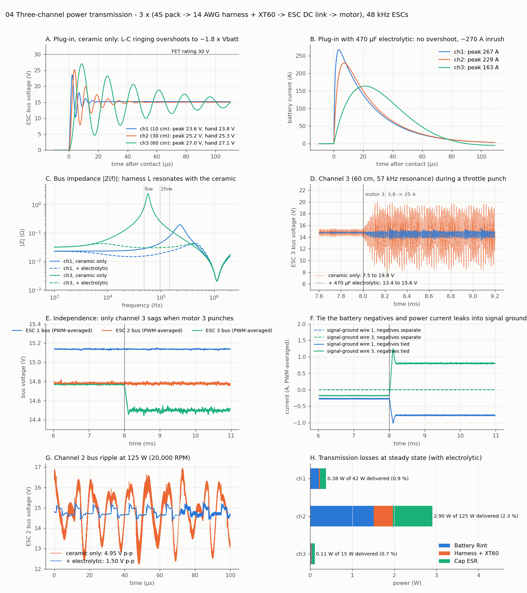

# 04 — Three-Channel Power Transmission (3 batteries → 3 motors, independent)

**Topology type:** three independent DC power channels: 4S pack → 14 AWG harness + XT60 → ESC DC link → ESC + motor load
**Builds on:** [03 FOC drive](../03_Three-Phase_FOC_PMSM/README.md). Each ESC + motor is replaced by its exact DC-bus current, Σ hₓ·iₓ.
**Design document (with all the math):** `04_Three-Channel_Power_Transmission_Design.pdf`

## The three channels
| Ch | Pack | Harness | Load |
|---|---|---|---|
| 1 | 15.2 V | 10 cm, wires side by side (47 nH) | 14,000 RPM, 42 W |
| 2 | 15.0 V | 30 cm, wires side by side (140 nH) | 20,000 RPM, 126 W |
| 3 | 14.8 V | 60 cm, wires 20 mm apart (770 nH) | 10,000 RPM, 15 W → punch to 25 A at 8 ms |

`.step param Case list 0 1 2`:
- **Case 0:** 10 µF ceramic only at each ESC.
- **Case 1:** adds a 470 µF electrolytic at each ESC.
- **Case 2:** Case 1 plus the battery negatives tied together.

## Files
| File | What it is |
|---|---|
| `ThreeChannel_Transmission.asc` | LTspice schematic. Open it and press Run (about 1 min for all 3 cases) |
| `gen_schematic.py` | Script that generated the schematic |
| `hand_calc.py` | All hand calculations: harness R/L, operating points, Kolar ripple, R-L-C plug-in, |Z(f)|, ground-loop nodal analysis |
| `plot_results.py` | Builds `ThreeChannel_Transmission_results.png` |
| `make_design_doc.py` | Builds the design PDF |

## Techniques new in this design
- **Switching-function load model:** the inverter's input current Σ hₓ·iₓ keeps every switching edge without FETs, motor or controller. The run is about 40× faster.
- **Two-wire-line inductance:** L = (μ0/π)·ln(s/r) per metre, plus the λ/10 rule for when a cable stops being lumped.
- **Kolar's DC-link ripple formula,** checked to within 0.3 %.
- **Second-order step response** for plug-in overshoot and inrush.
- **Impedance |Z(f)| as seen by the switching current:** this is how resonances are found before they ring.
- **Nodal analysis of a ground loop**, matched exactly by the simulation.
- **Pitfall found:** "removing" a capacitor by setting it to 1 nF next to a 10 nH lead creates a 50 MHz resonance. The first run produced a 4.7 GB raw file. Disconnect it through 1 MΩ instead.

## Results
| | Ceramic only | + 470 µF electrolytic |
|---|---|---|
| Plug-in peak voltage (ch3) | **27.0 V** (FETs rated 30 V) | 15.5 V |
| Plug-in peak current (ch1) | 168 A | **267 A** (the spark) |
| Ch2 bus ripple at 125 W | 4.95 V p-p | 1.50 V p-p |
| Ch3 bus during 25 A punch | **7.5 to 19.8 V** (57 kHz resonance) | 13.4 to 15.6 V |

- **Independence:** with separate packs, signal-ground current is about 10⁻¹⁰ A, and the other channels' buses don't move when motor 3 punches.
- **Negatives tied (Case 2):** up to 0.8 A of power current flows through 26 AWG signal wires.

## Lessons
1. The harness's inductance matters more than its resistance. I²R is under 1 % of delivered power.
2. Harness L plus the ESC ceramic forms a tank. Channel 3's 57 kHz resonance sits next to the 48 kHz PWM, with Q ≈ 8.
3. A bulk electrolytic is a damper, not just a reservoir. Its ESR is what kills the ringing.
4. Damping the plug-in overshoot turns it into a 270 A spark. Fixing that is the next topology (anti-spark / precharge).
5. Independent packs are isolated by KCL. Joining the negatives a second time creates a ground loop through the flight controller.

## Experiments to try
- Ch3 `Lloop3=180n` (the same 60 cm, but twisted): the resonance moves to about 120 kHz.
- `Fsw=24k`: does channel 3's ringing get better or worse?
- `Vb1=25.2` (6S): check the plug-in peak against 30 V FETs.
- `Fvf=50k`: the ESC feed-forward becomes a constant-power load at the resonance. Watch case 0.

**Note:** the `.raw` file is about 400 MB.
