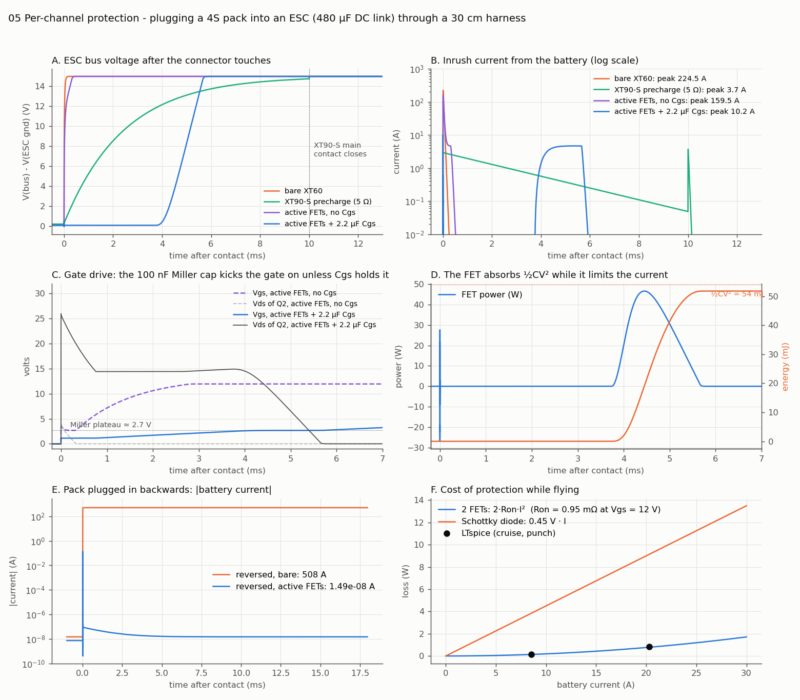

# 05 — Channel Protection: Soft-Start (Anti-Spark) + Reverse Polarity

**Topology type:** back-to-back N-MOSFETs (common source) in each channel's negative line, with a Miller-capacitor soft-start gate network
**Builds on:** [04 Three-channel transmission](../04_Three-Channel_Power_Transmission/README.md), channel 2 (30 cm harness, 480 µF ESC link). Fit the same block in each of the three channels.
**Design document (with all the math):** `05_Channel_Protection_Soft-Start_Reverse-Polarity_Design.pdf`

## Cases (`.step param Case list 0 1 2 3 4 5`)
| Case | What is plugged in | Result |
|---|---|---|
| 0 | Bare XT60 | **225 A** inrush spark |
| 1 | XT90-S style (5 Ω precharge contact, main contact 10 ms later) | 3.0 A, then a 3.7 A spark at the main contact |
| 2 | Active FETs, naive gate (no Cgs) | **160 A**: the plug-in dV/dt kicks the gate on through the Miller cap |
| 3 | Active FETs + 2.2 µF Cgs | **~4 A** controlled ramp, 4 ms delay, 1.3 ms ramp |
| 4 | Pack reversed, no protection | **508 A** through the ESC body diodes |
| 5 | Pack reversed, active FETs | 15 nA |

The protection costs 0.16 W at cruise (8.5 A) and 0.83 W at a punch (20 A). A Schottky diode would cost 3.8 W and 9.1 W.

## Files
| File | What it is |
|---|---|
| `ChannelProtection.asc` | LTspice schematic. Runs all 6 cases in about 2 s |
| `gen_schematic.py` | Script that generated the schematic |
| `plot_results.py` | Builds `ChannelProtection_results.png` and `extra_metrics.json` |
| `make_design_doc.py` | Builds the design PDF |

## Techniques new in this design
- **Back-to-back MOSFETs:** one FET's body diode blocks each direction.
- **Miller-plateau soft-start:** I_inrush = (Vb − V_plat)·C_dc / (Rg·Cm), set by passives only.
- **dV/dt-induced turn-on, and the Cgs fix:** Cgs > Cm·(2Vb/Vto − 1). It is sized for the contact ringing, not just the step. My first 1 µF passed by luck.
- **Energy conservation:** charging C from a source always dissipates ½CV², in the spark, the resistor or the FET.
- **Time-switched behavioral conductances** model connector contacts.
- **Simulation craft:**
  - Trapezoidal integration rang numerically after the punch (2 GB, no finish); `.options method=gear` fixed it.
  - A hard `V>9` load enable broke Newton convergence; a smooth tanh enable fixed it.
  - `read_meas` now accepts LTspice's `failed` measurements.

## Lessons
1. The spark energy is ½CV² = 54 mJ per plug-in, whatever you do. Protection only decides where it is dissipated.
2. A soft-start FET must survive ½CV² in its linear SOA and ≥ 2× pack voltage of Vds at the moment of contact.
3. An XT90-S only works if the hand is slow. The active circuit is independent of plug speed and also blocks reverse polarity.
4. A big Cgs slows full enhancement (τ ≈ 28 ms), so the ESC should arm about 100 ms after plug-in.

## Experiments to try
- `Rgate=6k`: about twice the inrush and half the ramp. Watch the FET's peak power.
- `Vb=25.2` (6S): does 2.2 µF still hold the gate? What Vds does Q2 see?
- `Tpre=1m`: an XT90-S pushed in quickly.
