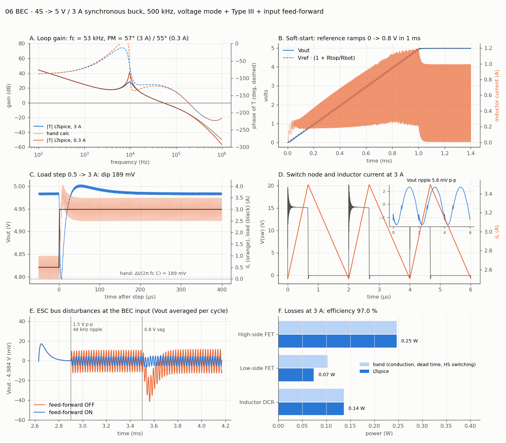

# 06 — BEC: 4S → 5 V / 3 A Synchronous Buck

**Topology type:** synchronous buck DC-DC converter, voltage-mode control, Type-III compensation, input-voltage feed-forward
**Feeds from:** one channel's ESC bus ([04](../04_Three-Channel_Power_Transmission/README.md)), including its 48 kHz ripple and throttle-punch sag
**Design document (with all the math):** `06_BEC_Synchronous_Buck_5V_Design.pdf`

## Design
| | |
|---|---|
| Input | 12.8–16.8 V (4S), nominal 15.2 V |
| Output | 4.984 V (0.8 V reference, 52.3k/10k divider), 3 A |
| Switching | 500 kHz, 20 ns dead time, RgH = 10 Ω / RgL = 1 Ω |
| L / Cout | 6.8 µH (15 mΩ) / 3 × 22 µF X7R, about 40 µF after DC-bias derating |
| Compensation | Type III: R2 18.7k, C1 1.8n, C2 33p, R3 1.43k, C3 470p |
| Loop | fc = 53 kHz, phase margin 57° at 3 A and 55° at 0.3 A |

## Files
| File | What it is |
|---|---|
| `BEC_Buck.asc` | Switching model: soft-start, load steps, ESC ripple and sag; `.step FF 0 1` (about 2.5 min) |
| `BEC_Buck_AC.asc` | Averaged model: `.ac` loop gain by Middlebrook injection, at 3 A and 0.3 A (1 s) |
| `hand_calc.py` | Power stage, plant, Type-III placement (R2 found by search), margins, line rejection |
| `gen_schematic.py` | Generates both schematics from the same values |
| `plot_results.py` / `make_design_doc.py` | Plots / design PDF |

## Results (hand → LTspice)
- **Loop:** fc 52.4 → 53.1 kHz; phase margin 58.6° → 57.1° at 3 A and 56.2° → 54.7° at 0.3 A.
- **Load step 0.5 → 3 A:** dip 192 → 189 mV (ΔI/(2π·fc·C)).
- **48 kHz ESC ripple at the output:** 9.9 → 11.1 mV without feed-forward, 4.3 → 4.7 mV with it.
- **0.8 V input sag:** 42 mV dip without feed-forward, 6.5 mV with it.
- **Efficiency at 3 A:** 96.9 % → 97.0 %.

## Lessons (several came from things that went wrong first)
1. With ceramic output capacitors, voltage mode needs Type III. Count the capacitors at their derated value.
2. **Shoot-through from Cdv/dt.** With 2 Ω gate resistors the switch node slewed at 40 V/ns and kicked the low-side gate to 3.4 V. The low-side FET lost 0.53 W and efficiency was 95.1 %. Reverse recovery was suspected first but ruled out by rerunning with Tt=0. RgH = 10 Ω / RgL = 1 Ω fixed it: efficiency rose to 97.0 %.
3. **Feed-forward needs a filtered sense.** Fed from raw Vin, the ramp amplitude carried switching spikes and the comparator chattered (17 W in the high-side FET).
4. **Start-up artifact.** With the sawtooth at 0 during the DC operating point, the high-side FET was "on", so the output started at 15 V. A gate enable that keeps both FETs off at t = 0 fixed it, as real controllers do.
5. The input wire (30 nH) and Cin resonate at 291 kHz, so Cin carries 36 % more RMS current than the textbook formula predicts.

## Experiments to try
- `Cout=66u` (forget derating) in `hand_calc.py`, then rerun the AC model. How much does the margin change?
- `RgH=2 RgL=2`: bring the shoot-through back and watch `pls` and the low-side gate in the plot.
- `Fff=20k`: a slower feed-forward filter. Does the 48 kHz rejection improve or get worse?

**Note:** `BEC_Buck.raw` is about 1.2 GB. Delete it if you need the space; rerunning recreates it.
