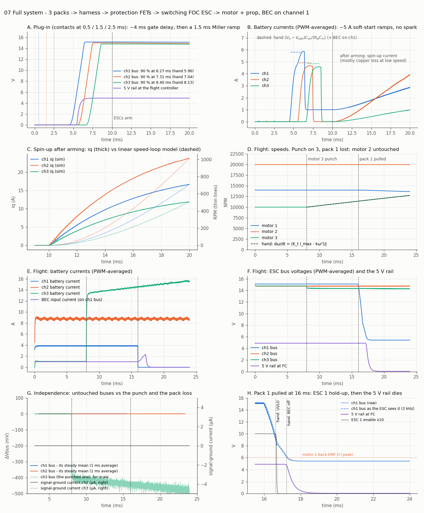

# 07 — Full System: 3 Packs → 3 Motors

**Topology type:** three complete, independent power channels. Each one runs: 4S pack → connector → 14 AWG harness → back-to-back N-FET protection (− line) → ESC DC link → switching 3-phase inverter + sensored FOC → PMSM + prop. A 5 V BEC (averaged model) sits on channel 1's bus.
**Builds on:** [03 FOC](../03_Three-Phase_FOC_PMSM/README.md) (inverter, controller, motor), [04 transmission](../04_Three-Channel_Power_Transmission/README.md) (packs, harnesses, grounding), [05 protection](../05_Channel_Protection_Soft-Start_Reverse-Polarity/README.md) (soft-start FETs), [06 BEC](../06_BEC_Synchronous_Buck_5V/README.md) (5 V rail).
**Design document (with all the math):** `07_Three-Channel_Full_System_Design.pdf`

## The two runs
| Run | What happens | Run time |
|---|---|---|
| `FullSystem_PlugIn.asc` (20 ms) | Packs plugged in at 0.5 / 1.5 / 2.5 ms, soft-start, BEC start-up, ESCs arm at 10 ms and start a 120 ms speed ramp | ~24 min, 1.1 GB raw |
| `FullSystem_Flight.asc` (24 ms) | Motors start at 14,000 / 20,000 / 10,000 RPM (`.ic` + pre-loaded integrators), steady 4–8 ms, motor 3 punches to 16,000 RPM at 8 ms, pack 1 is pulled at 16 ms | ~46 min, 2.1 GB raw |

The two runs were done in parallel with `run_both.sh`. Wait for the LTspice process to exit, because the `.meas` results are written after "Total elapsed time".

## Files
| File | What it is |
|---|---|
| `gen_schematic.py` | Generates both schematics (`python3 gen_schematic.py [plugin] [flight]`) |
| `hand_calc.py` | All predictions: power chain, ESC loss, DC-link ESR loss (Kolar), bus quadratic, soft-start, speed-loop model, punch ODE, hold-up |
| `plot_results.py` | Builds `FullSystem_results.png` and `extra_metrics.json`; memory-maps the multi-GB raw files |
| `make_design_doc.py` | Builds the design PDF: hand calc vs. the `.meas` results of both `.log` files |
| `run_both.sh` | Runs LTspice batch jobs in parallel under Wine |

## Results (hand → LTspice)
| | Hand | LTspice |
|---|---|---|
| Battery currents, steady flight (A) | 3.876 / 8.761 / 1.068 | 3.873 / 8.759 / 1.069 |
| Bus voltages (V) | 15.105 / 14.755 / 14.765 | 15.105 / 14.755 / 14.765 |
| Protection-FET loss (mW) | 28.6 / 146 / 2.2 | 33.4 / 152 / 2.2 (RMS vs mean current) |
| System efficiency (shaft + avionics / chemical) | 86.0 % | 86.1 % |
| Soft-start inrush (A) | 4.9 (ideal formula) | 4.3–5.0 (−11 %, as in 05) |
| Spin-up iq, 15–20 ms (A) | 14.36 / 20.52 / 10.26 | 14.38 / 20.54 / 10.27 |
| Motor 3 punch, ω at 15 ms (rad/s) | 1177 | 1176 |
| Pack 1 pulled → ESC 1 UVLO | 0.63 ms | 0.63 ms |
| Pack 1 pulled → 5 V rail lost | 1.22 ms | 1.26 ms |

**Independence:** a 30 A punch on motor 3 sags its own bus by 436 mV. The other buses move by under 0.11 mV and the other motors by under 0.5 RPM. Signal-ground currents of channels 2 and 3 average about 1e-11 A.

## Techniques new in this design
- **Starting a slow mechanical system in steady state:** `.ic` on ω, θ and the phase currents, plus `idt(x, ic)` to pre-load the PI integrators. The system is in steady flight within ~1 ms instead of 250 ms.
- **Averaged BEC** (constant power, dropout, UVLO, soft-start) instead of a 500 kHz switcher. It is valid for the system-level questions because 06's loop crosses at 53 kHz.
- **DC-link ESR loss from Kolar's ripple formula.** This closed the last 1 % between hand and simulation.
- **Constant-power hold-up:** ½C(V0² − V²) = P·t predicts the UVLO time to 0.2 %.
- **Column-selective memmap reading** of multi-GB `.raw` files.

## What went wrong first
1. Feeding the raw bus voltage into the duty feed-forward and UVLO caused a relaxation oscillation and 25 ps time steps. A 3 kHz bus-sense filter fixed it, as in 04.
2. A 2 nH ceramic ESL rang with the FET capacitances at every edge. It was removed, as in 03, which made the run ~70× faster.
3. LTspice prints "Total elapsed time" minutes before it writes the `.meas` lines of a 2 GB run.

## Lessons
1. With floating packs, the channels really are independent, even with switching inverters, protection FETs and a 3 A avionics return.
2. The power chain is predictable to ~1 % by hand when ESC loss, capacitor ESR loss and RMS currents are counted.
3. **Single point of failure:** with the BEC on channel 1, losing pack 1 drops the flight controller after ~1.3 ms, while motors 2 and 3 keep running blind. → topology 08.
4. After losing its pack, a spinning motor rectifies its back-EMF through the body diodes and holds its bus at ~5.4 V. That is below the BEC's UVLO, so it cannot save the rail.

## Experiments to try
- Put the BEC on channel 2 (the 20,000 RPM channel). Does its bigger ripple reach the 5 V rail?
- `Vbec_uv=4.5`: does the motor-1 generator keep the BEC alive after pack 1 is lost?
- Raise channel 1's DC link to 2,000 µF. How much rail hold-up time does that buy?
