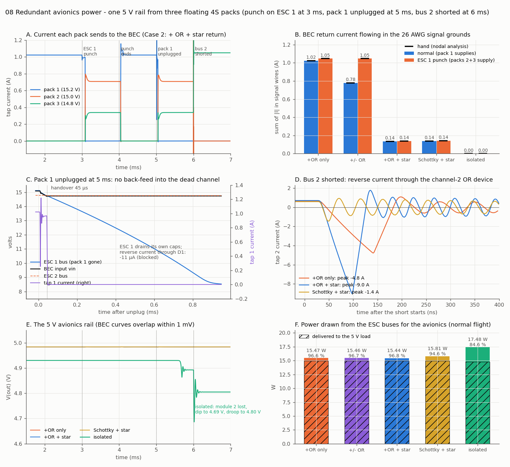

# 08 — Redundant Avionics Power (one 5 V rail from three floating packs)

**Topology type:** ideal-diode OR-ing of three floating 4S channels into one BEC, with a deliberate star return
**Builds on:** [04 three-channel transmission](../04_Three-Channel_Power_Transmission/README.md) (packs, harnesses, signal grounds) and [06 BEC](../06_BEC_Synchronous_Buck_5V/README.md) (averaged model)
**Design document (with all the math):** `08_Redundant_Avionics_Power_Design.pdf`

## The question
The three packs float, with separate negatives that meet only at the flight controller through 26 AWG signal grounds (04). The BEC is a non-isolated buck with a single ground. OR-ing the positives is easy. The real question is which way the BEC's return current goes home to the pack that supplied it.

## Five architectures (`.step param Case list 0 1 2 3 4`)
| Case | + rail | Return to the packs | Signal-wire current (normal) | Power from packs |
|---|---|---|---|---|
| 0 | ideal diode ×3 | signal grounds only | **1.02 A** | 15.47 W |
| 1 | ideal diode ×3 | ideal diode ×3 + 18 AWG | **0.78 A** (the diode is shunted) | 15.46 W |
| 2 | ideal diode ×3 | 18 AWG star wire ×3 | 0.14 A | **15.44 W** |
| 3 | Schottky ×3 | 18 AWG star wire ×3 | 0.14 A | 15.81 W |
| 4 | isolated DC-DC ×3 | none | 0 | 17.48 W |

Timeline in every case: normal flight → 365 W punch on ESC 1 (3–4 ms) → pack 1 unplugged (5 ms) → bus 2 shorted through 5 mΩ (6 ms).

**Recommended: Case 2.** Put an ideal diode in each + tap. Bring the three − taps to the BEC ground as one star at the ESC ground pads. Never tie the pack negatives a second time.

## Files
| File | What it is |
|---|---|
| `Redundant_Avionics.asc` | LTspice schematic. Open it and press Run (all 5 cases in about 25 s, 56 MB raw) |
| `gen_schematic.py` | Script that generated the schematic; all values come from `hand_calc.py` |
| `hand_calc.py` | OR sharing solver, ground-network nodal analysis, droop sharing, handover, hold-up, reverse-current model |
| `plot_results.py` | Builds `Redundant_Avionics_results.png` and `extra_metrics.json` |
| `make_design_doc.py` | Builds the design PDF (hand vs LTspice table) |

## Techniques new in this design
- **Behavioural ideal-diode controller (LM74700-style).** A gate integrator regulates V_AK to 20 mV, a −11 mV reverse comparator with a 0.3 µs lag drives a 2.4 A pull-down, and the gate charge pump is 2.7 mA. In regulation the FET is barely on: R_DS = Vreg/I.
- **An OR is a selector, not a sharer.** Water-filling solution of the Thévenin paths. Packs share only when their buses are within millivolts.
- **Return-path current dividers.** A − rail diode regulating to 20 mV next to a 27 mΩ wire conducts nothing below 0.74 A.
- **"A loop needs two joins at different points."** Star wires and signal wires both join at the ESC end, so they form a mesh, not a loop.
- **Reverse-current timing:** a ramp through a first-order comparator lag, t_det ≈ √(2τ·31 mV/k).
- **Droop sharing** of the isolated modules behind ideal diodes.

## Results (hand → LTspice)
- **Sharing:** pack 1 supplies 1.0220 → 1.0219 A. During the punch packs 2 and 3 share 0.707/0.339 → 0.708/0.339 A.
- **Case 1 split:** signal wire 0.778 → 0.778 A, return diode 0.245 → 0.245 A.
- **Loss at 1 A:** ideal diode 20.4 → 20.4 mW; Schottky 381 → 381 mW (V_F 364 mV).
- **Unplug:** handover 44.5 → 44.7 µs, carried by ESC 1's 480 µF. Reverse current into the dead channel: 11 µA.
- **Bus 2 short:** detection 71 → 66 ns; reverse peak 9.35 → 9.0 A (Case 2); Schottky 1.4 A (capacitive only).
- **5 V rail:** it moves less than 1 mV in every event in Cases 0–3 (06's feed-forward). Case 4 dips to 4.69 V and droops to 4.80 V once only one module is left.
- **Isolated:** droop shares 1.5/1.0/0.5 A exactly, but uses 2.0 W more from the packs.
- **Hold-up:** the BEC's 10 µF alone lasts only 64 µs with no pack left. OR-ing gives redundancy, not hold-up.

## Lessons (several came from things that went wrong first)
1. **The negatives are already joined once** (at the FC). Whatever return you add must join at the same end, or you rebuild 04's loop (0.65 A of motor current in a signal wire).
2. **Ideal diodes in the − rail don't help** while a signal ground sits in parallel. Their 20 mV regulation pushes the current into the thin wire.
3. **A constant-power load must have finite bandwidth.** The first run used an instantaneous P/V for the ESCs. That is a negative resistance at every frequency: it oscillated against the capacitors' nH-level ESL, the bus swung from −30 to +66 V, and the run stalled. Sensing the bus through 04's 3 kHz filter fixed it.
4. **A millivolt matters to a Schottky.** The 1 mΩ on-resistance of the unplug switch (25 mV at 25 A) made pack 1's Schottky current 2.5× too low. A 10 µΩ switch fixed it.
5. **Gear integration.** Trap is fine until the short, then stalls in the ~20 MHz ring after the FET avalanches (1.1 GB, no finish). Gear runs all five cases in 25 s, with the same steady-state numbers.

## Experiments to try
- `Rret` = 8 AWG-heavy (1 mΩ): the signal-wire share drops from 13 % to 4 %.
- `Tsense=1u`: slower reverse detection. Watch the peak reverse current grow (hand: ∝ √τ).
- `Vb3=15.2`: three packs at the same voltage. Does the OR share three ways?
- `Cin=1000u` with all three packs removed: how long does the 5 V rail survive?
- `Rdroop=10m` in Case 4: tighter regulation, but worse sharing between the modules.
