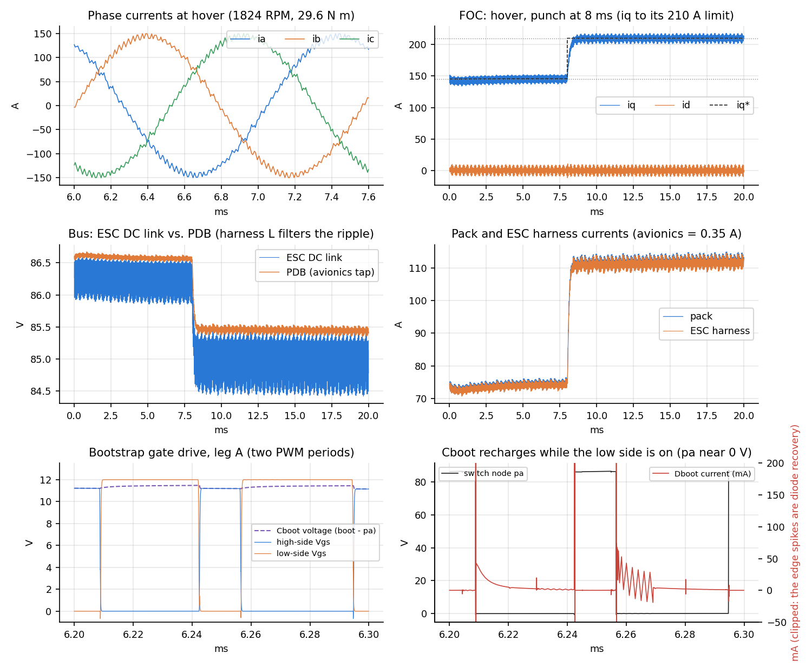
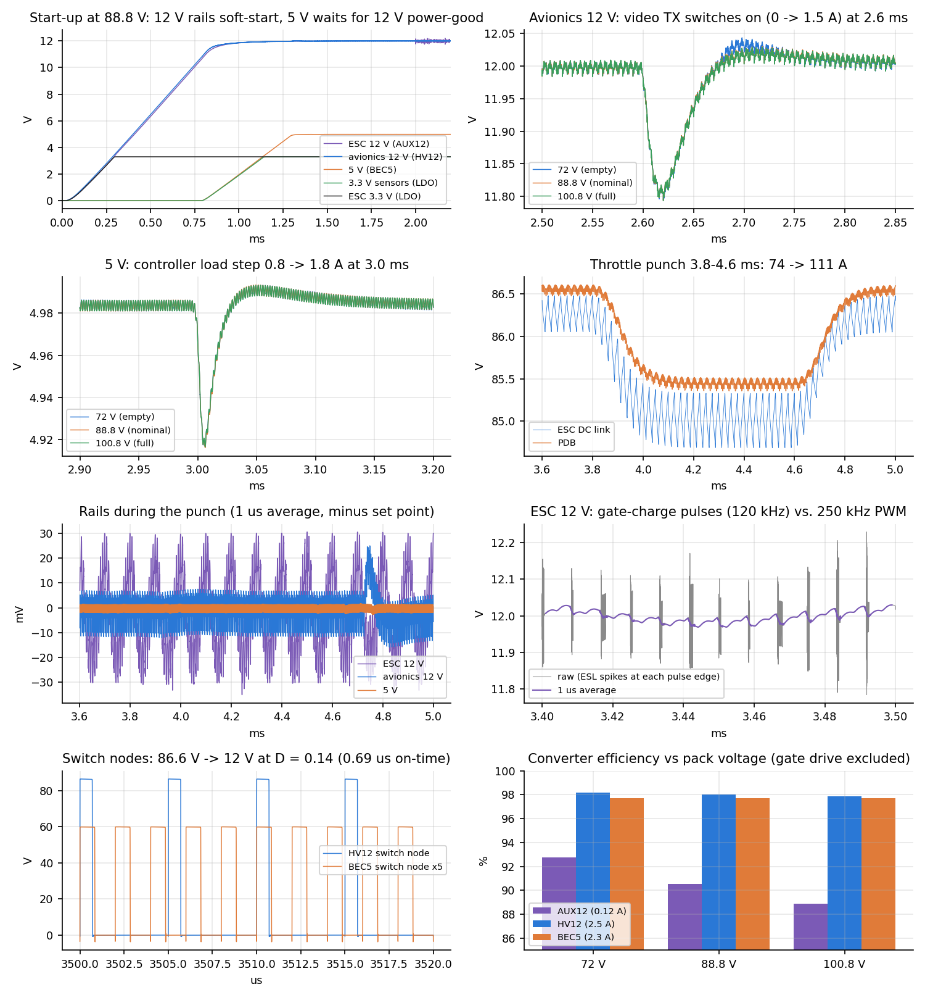

# 09 — 24S FOC Drive and Low-Voltage Rails

**Topology type:** one channel of the real tricopter (Props/01), powered from its 24S pack (72 / 88.8 / 100.8 V), with every low-voltage supply the aircraft needs.

```
24S pack ─ PDB ─┬─ 8 AWG harness ─ ESC DC link ─┬─ 150 V inverter + FOC (03) ─ U15XL + 54x18 prop
                │                               └─ AUX12 buck 12 V/0.5 A ─┬─ bootstrap gate drivers
                │                                                         └─ 3.3 V LDO (ESC microcontroller)
                └─ HV12 buck 12 V/5 A ─┬─ video / telemetry transmitter (12 V)
                                       └─ BEC5 = 06's buck, 5 V/3 A ─┬─ flight controller + receiver
                                                                     └─ 3.3 V LDO (sensors)
```

**Builds on:** [03 FOC](../03_Three-Phase_FOC_PMSM/README.md) (controller), [06 BEC](../06_BEC_Synchronous_Buck_5V/README.md) (the 5 V buck and the design method), [07](../07_Three-Channel_Full_System/README.md) (each ESC owns its supply; constant-power bus; .ic start at speed), [08](../08_Redundant_Avionics_Power/README.md) (in the full aircraft, the avionics supply is OR-ed from all three packs).
**Design document (with all the math):** `09_24S_FOC_Drive_Low-Voltage_Rails_Design.pdf`

## Runs
| File | What it shows | Run time |
|---|---|---|
| `Drive_24S.asc` (20 ms) | Switching inverter with **real bootstrap gate drivers** fed from the ESC's 12 V rail; U15XL at hover from t = 0 (.ic), throttle punch to the 210 A iq limit at 8 ms | ~40 s, 49 MB |
| `Rails_Switching.asc` (5 ms × 3) | All three bucks switching: start-up sequencing, transmitter switch-on, controller load step, throttle punch; `.step` over 72 / 88.8 / 100.8 V | ~75 s, 270 MB |
| `Rails_AC.asc` | Loop gain of all three bucks (averaged switch + Middlebrook injection), full and 10 % load | 3 s |
| `GateCharge.asc` | Datasheet-style gate-charge test of the inverter switch: Qg sets the gate-drive current | 4 s |

## Files
| File | What it is |
|---|---|
| `hand_calc.py` | All predictions. `Buck` designs any of the three converters (ripple, Type III placement, E96 snapping, margins, line/load transients, loss budget) |
| `gen_schematic.py` | Generates the four `.asc` files (`python3 gen_schematic.py [rails] [drive] [ac] [qg]`) |
| `plot_results.py` | Builds the PNGs and `extra_metrics.json` |
| `make_design_doc.py` | Builds the design PDF from the hand calcs and the four `.log` files |

## Results (hand → LTspice)
| | Hand | LTspice |
|---|---|---|
| Hover iq (A) | 145.2 | 145.1 |
| DC-link / PDB voltage at hover (V) | 86.267 / 86.570 | 86.268 / 86.571 |
| Pack current at hover (A) | 74.34 | 74.29 |
| Drive efficiency, shaft / ESC input | 88.58 % | 88.62 % |
| DC-link capacitor RMS, Kolar (A) | 61.7 | 62.9 |
| Inverter loss (W) | 76.8 | 70.4 |
| Gate charge per switch (nC) | 279 | 302 (bench) |
| Punch: iq 10–90 % rise (µs) | 350 | 352 |
| Punch: ESC current (A) | 110.9 | 111.4 |
| Loop crossover / PM: AUX12, HV12, BEC5 | 18.7 kHz 65° / 18.8 kHz 60° / 52.5 kHz 59° | 18.8 kHz 64° / 18.8 kHz 59° / 53.1 kHz 57° |
| Rails at 88.8 V: 12 V ESC / 12 V avionics / 5 V / 3.3 V | 12.000 / 12.000 / 4.984 / 3.290 | 11.998 / 11.998 / 4.984 / 3.290 |
| Transmitter on: 12 V dip (mV) | 202 | 205 |
| Efficiency AUX12 / HV12 / BEC5 | 92.2 / 98.1 / 97.5 % | 90.5 / 98.0 / 97.7 % |
| Bus ripple: ESC DC link / PDB (V p-p, Run 2) | 0.66 / — | 0.76 / 0.11 |

All three pack voltages (72 / 88.8 / 100.8 V) give the same rail voltages to the millivolt. The throttle punch moves the 12 V rails by about 3 mV by hand, below their switching ripple, so it is invisible in LTspice.




## Techniques new in this design
- **One buck design procedure reused three times** (`hand_calc.Buck`): it designs a 100 V → 12 V, a 100 V → 12 V at 0.5 A and 06's 12 V → 5 V converter, and LTspice agrees on every crossover to within 1 kHz and every phase margin to within 1.5°.
- **Feed-forward makes the loop input-independent**, so 06's compensator works unchanged at 12 V, and the 100 V bucks keep their margins across the whole 72–100.8 V pack range.
- **Two-stage step-down** (100 → 12 → 5 V) avoids a 99 ns on-time.
- **Bootstrap gate drive modelled with real charge flow**: the high-side driver is a pair of B-source current switches fed from Cboot, so the gate charge really comes out of the 12 V rail through Dboot.
- **Gate-charge test bench**, the datasheet method in LTspice. The hand formula Cgs·V + Cgd,min·Vds + Cgd,max·(V − Vplat) is within 8 %.
- **Calibrating the motor's missing losses** (iron, bearings, windage) on a vendor bench point, as a drag torque Bfric·ω.

## What went wrong first
1. The gate-charge bench had no DC operating point: a constant 10 mA into a capacitor with a hard `(V(g)<14)` cut-off. A time ramp from zero plus a tanh roll-off fixed it.
2. The 5 V soft-start capacitor charged from a current source had no DC path, so the node floated. A 100 MΩ bleed resistor fixed it.
3. One `.meas` used V(wref), which was not in `.save`, so LTspice dropped every measurement.
4. The first hand Qg (Cgs·V + Qgd) was 12 % low. It left out the Miller capacitance above the plateau, where Cgd is at its large low-Vds value.
5. **The power-tree run stalled at 16 µs with 0.5 ps time steps** (3.4 GB raw in 37 min). Bisecting by swapping blocks for resistors found the cause: the 3.3 V LDO. It was a voltage source `max(min(3.3, Vin − 0.25), 0)` behind 20 mΩ, with its input current copied from that resistor. At the operating point it still put out about 10 mV with no input, its load pulled about 90 µA, and it took that current from the dead 12 V rail. That dragged the rail to −0.5 V and wound the AUX12 error amplifier up to its limit before start-up. Rewriting the LDO as a pass device, I = Gm·(3.3 − Vout) from input to output, so that it cannot create power, made the run take 75 s. **Lesson:** a behavioural block that can source power from nothing will find a way to. Write models whose input current *is* their output current.
6. LTspice sorts a `.step ... list`: `88.8 72 100.8` ran as 72 / 88.8 / 100.8. Index the steps by value, not by the order you wrote them.
7. The raw ESC 12 V ripple (0.44 V p-p) is dominated by 10 ns ESL spikes at each gate-charge pulse. Report the 1 µs average (60 mV), and on a real board give each gate driver its own 1 µF ceramic.

## Assumptions to replace with measurements
Phase inductance (25 µH), pole pairs (21), rotor + prop inertia (0.15 kg·m²), pack resistance (30 mΩ), and the avionics currents (5 V: 1.8 A, 12 V: 1.5 A, 3.3 V: 0.5 A).
