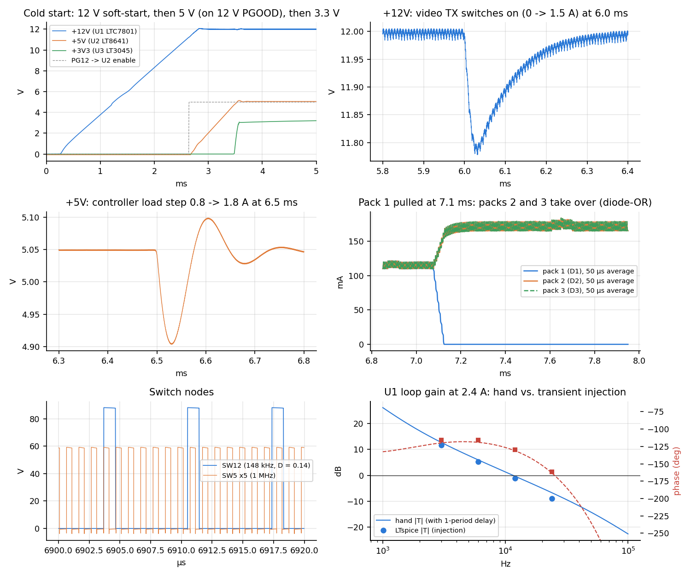

# 10 — Hardware Schematics: ESC Board and Avionics Power Board

**Topology type:** topology 09 turned into two real PCBs with real parts. Each board is one LTspice schematic you can run, plus a BOM and a net list you can redraw in KiCad.

| Board | Qty per aircraft | What it does |
|---|---|---|
| **ESC board** (`ESC_Board.asc`) | 3 (one per motor) | 24S DC link → 3 × LTC7063 gate drivers → 24 × IPB065N15N3 (4 in parallel per switch) → U15XL. It has its own LTC7801 12 V aux supply, LT1763 5 V / 3.3 V, two ACS770 ±200 A current sensors and an STM32G431 running FOC. |
| **Avionics power board** (`Avionics_Board.asc`) | 1 | Three 24S packs → fuses + diode-OR → LTC7801 12 V / 5 A (transmitter) → LT8641 5 V / 3 A (flight controller + receiver) → LT3045 3.3 V / 0.3 A (sensors). |

**Builds on:** [09](../09_24S_FOC_Drive_Low-Voltage_Rails/README.md) (the design these boards implement), [03](../03_Three-Phase_FOC_PMSM/README.md) (FOC), [06](../06_BEC_Synchronous_Buck_5V/README.md) (buck design), [08](../08_Redundant_Avionics_Power/README.md) (avionics fed from all three packs).
**Design document (with all the math):** `10_Hardware_Schematics_ESC_Avionics_Design.pdf`

## Files
| File | What it is |
|---|---|
| `board.py` | Builder: one parts table → `.asc` + BOM + net list (they can't drift apart) |
| `hand_calc.py` | All predictions (`python3 hand_calc.py`, `python3 hand_calc.py esc`) |
| `avionics.py`, `esc.py` | The two boards. `python3 avionics.py loop` also writes the loop-gain test |
| `*_BOM.csv` | Reference, quantity, description, value, part number / specification, **KiCad footprint**, rating |
| `*_Netlist.csv` | Every net with every `REF.pin` on it, the wiring list for KiCad (simulation-only parts removed) |
| `plot_results.py`, `make_design_doc.py` | Plots and the design PDF |

## Running the simulations
Open the `.asc` in LTspice and press Run, or in batch:
```bash
wine "$HOME/.wine/drive_c/Program Files/ADI/LTspice/LTspice.exe" -b ESC_Board.asc
```
| Run | Shows | Time |
|---|---|---|
| `Avionics_Board.asc` (8 ms) | Cold start and sequencing, transmitter switch-on, controller load step, pack 1 pulled | ~10 min |
| `Avionics_LoopTest.asc` | 12 V loop gain at 3 / 6 / 12 / 24 kHz by injection, on the switching circuit | ~5 min |
| `ESC_Board.asc` (13 ms) | Cold start of the ESC electronics with the rotor at hover, flying start, throttle punch | ~7 min |

Parts named `V_…`, `B_…`, `L_HARN`, `R_CS…`, `R_BW…`, `C_BW…`, `La/Lb/Lc`, `C_J`, `C_TH`, `R_LK…`, `R_VBF`, `C_VBF`, `C_VTX` are simulation stimulus or models: the packs, the loads, the motor, and the STM32's FOC firmware as a behavioural block. Everything else is a board part with its real reference designator.

## Porting to KiCad
1. **One schematic per board**, with one hierarchical sheet per numbered block (the framed areas in the `.asc`): e.g. ESC = 1 power input, 2 aux supply, 3 logic supplies, 4–6 legs A/B/C, 7 current sense, 8 MCU and connectors. Use global labels for the nets that cross sheets (`VBUS`, `+12V`, `+5V`, `+3V3`, `PWM_A`…).
2. **Symbols.** KiCad's stock library has the STM32G431CBTx, the ACS770 family, the LT3045 and the AS5047. The **LTC7801, LTC7063, LT8641 and LT1763 are not in KiCad's library**: download them from ADI's product pages or SnapEDA / Ultra Librarian. Pin names in the net list are LTspice's names (`SENSE+`, `BGRTN`, `_FLT` = FLT-bar, `_SHDN` = SHDN-bar); match them to the datasheet pin names, not to pin numbers.
3. **Wire from `*_Netlist.csv`**: each row is one net and every pin on it. Parts listed with a quantity (e.g. `Q4 Q5 Q6 Q7`) are parallel copies with identical connections.
4. **Footprints** are in the BOM, by their KiCad library names (checked to exist in KiCad 9). Two are marked *custom*: the LT8641's LQFN-18 and the AS150 battery connector.
5. **The MCU pin map is a proposal.** TIM1 CH1–3 on PA8–PA10 for the gate drivers, ADC1 on PA0–PA3, SPI1 on PA4–PA7 for the encoder, SWD on PA13/PA14. Check every alternate function in STM32CubeMX before you route.

## Layout rules that the schematic can't show
- **Power loop first.** Per leg, the loop from the DC-link ceramics (C17–C26) through the high-side and low-side FETs must be as small as possible. Put the ceramics right across each leg, with the polymer capacitors next to them.
- **Current.** 110 A punch, 74 A hover: use 3 oz copper or bus bars on VBUS, GND and the phases. The motor leads need about 6–8 AWG.
- **100 V spacing.** Keep at least 0.6 mm clearance between 100 V nets and logic. Keep the bootstrap nodes (`BST_x`, `PH_x`) away from the MCU.
- **Gate drive.** Each LTC7063 goes next to its leg. Route TG with its return SW (and BG with BGRTN) as tight pairs, put one gate resistor at each FET, and place the bootstrap diode and capacitor at the driver.
- **Grounds.** Power ground (FET sources, DC link) and signal ground (MCU, ADC dividers, LDOs) join at one point near the DC-link negative. The ACS770 is isolated, so its output side belongs to signal ground.
- **Sense lines.** Use a Kelvin connection on R1 / R7 (current sense) to SENSE+ / SENSE−, and route the ADC lines (ISNS_x, VBUS_SNS) as guarded traces away from the switch nodes.
- **Thermal.** About 70 W of FET loss at hover, so the 24 D2PAKs need a heatsink. The NTC (R6) goes on it.

## Results (hand → LTspice)
**Avionics board**
| | Hand | LTspice |
|---|---|---|
| +12V / +5V / +3V3 (V) | 12.000 / 4.988 / 3.320 | 11.995 / 5.046 / 3.286 |
| 12 V loop: crossover / phase margin | 11.57 kHz / 49.8° | 10.59 kHz / 53.0° (transient injection) |
| Current per pack, all three connected (A) | 0.112 | 0.113 |
| Packs 2 and 3 after pack 1 is pulled (A) | 0.167 | 0.169 (12 V moves 17 mV) |
| Transmitter switch-on: 12 V dip (mV) | 198 | 219 |
| 12 V stage / whole board efficiency | 97.9 % / 93.8 % | 95.6 % / 91.8 % |

**ESC board** (hand evaluated at the operating point LTspice reached: iq = 160.4 A, ω = 190.7 rad/s)
| | Hand | LTspice |
|---|---|---|
| Cold start: 12 V up / drivers enabled | 0.72 ms + delay / 1.5 ms (MCU) | 1.00 ms / FAULT_N high at ~1.6 ms |
| +12V minimum at driver enable (V) | 11.0 (charge sharing) | 9.86 |
| iq read by the MCU vs. true (A) | 160.4 | 159.6 (-0.5 %) |
| ESC input = electromagnetic + copper + inverter (W) | 6660 + 328 + 97 | 7102 = 6660 + 329 + 105 |
| Dead time at Vgs = 3 V (DT = 150 kΩ) | — | 142 / 141 ns |
| Bootstrap current, 3 legs (mA) | 25.3 | 24.4 |
| Bootstrap voltage (V) | 12 − Vf − Qg/C | 11.04–12.12 |
| Punch: iq / ESC current (A) | 210 | 210.5 / 112.3 |




## What went wrong first
1. **Units.** The `.asc` files were first written as UTF-8 with `µ`. LTspice read it as two Latin-1 characters and dropped the unit: 47µ became 47 H and nothing started. `board.py` now writes `u` in Latin-1.
2. **Library models looked missing** from a bare `.cir` test. LTspice loads its standard libraries only for `.asc` files. Confirm a model by measuring it (Ron with 1 V / 1 mΩ), not by the absence of an error.
3. **`aux.asc` cannot be opened under Wine**: AUX is a reserved DOS device name.
4. **Net-name collision**: the aux supply's gate nets were `TG_A` / `BG_A`, the same as leg A's. Two gate drivers drove each other's FETs and +12V reached 45 V. In a net-label schematic the names are the wiring, so the aux nets are now `_AUX`.
5. **Constant-current loads** dragged rails negative at start-up and broke the LDO models. Every load now scales with limit(V/Vnom, 0, 1).
6. **`.ic` on an encrypted controller** (soft-start pin, output rail) gave impossible operating points (29 A in L1 at t = 0). The electronics now start cold, and only the rotor speed is preset.
7. **Missing parts the simulation found**: gate-source pull-downs (high-side FETs drifted on through Cgd while the drivers were unpowered), the LT1763 bypass capacitors (they slow start-up by several ms; now do-not-fit), and 12 V bulk (driver enable dipped +12V to 7.4 V; a 47 µF fixes it).
8. **Burst Mode** on the avionics 12 V gave a 90 mV, 25 kHz sawtooth at light load, so MODE is tied to INTVCC (forced continuous).
9. **The sensor model lied**: a 1 kΩ bandwidth resistor in the ACS770 model lost 3 % into the ADC divider (now 10 Ω + 133 nF).
10. **"Efficiency" of 76.6 %** was the rotor still accelerating after the coast (649–867 W into ½Jω²). The energy balance closes once that is counted.
11. **`ltraw.read_meas`** returned the threshold of WHEN measurements instead of the time. Fixed for every topology.

## Assumptions to replace with measurements
Inherited from 09: motor Lph 25 µH, 21 pole pairs, rotor inertia 0.15 kg·m², pack resistance 30 mΩ, and the avionics currents. New here: the LTC7801's ITH gain (assumed 1/12, measured ≈ 1/13), the supply currents of the STM32 / ACS770 / AS5047, and the derated capacitances of the ceramics at their bias voltage.
