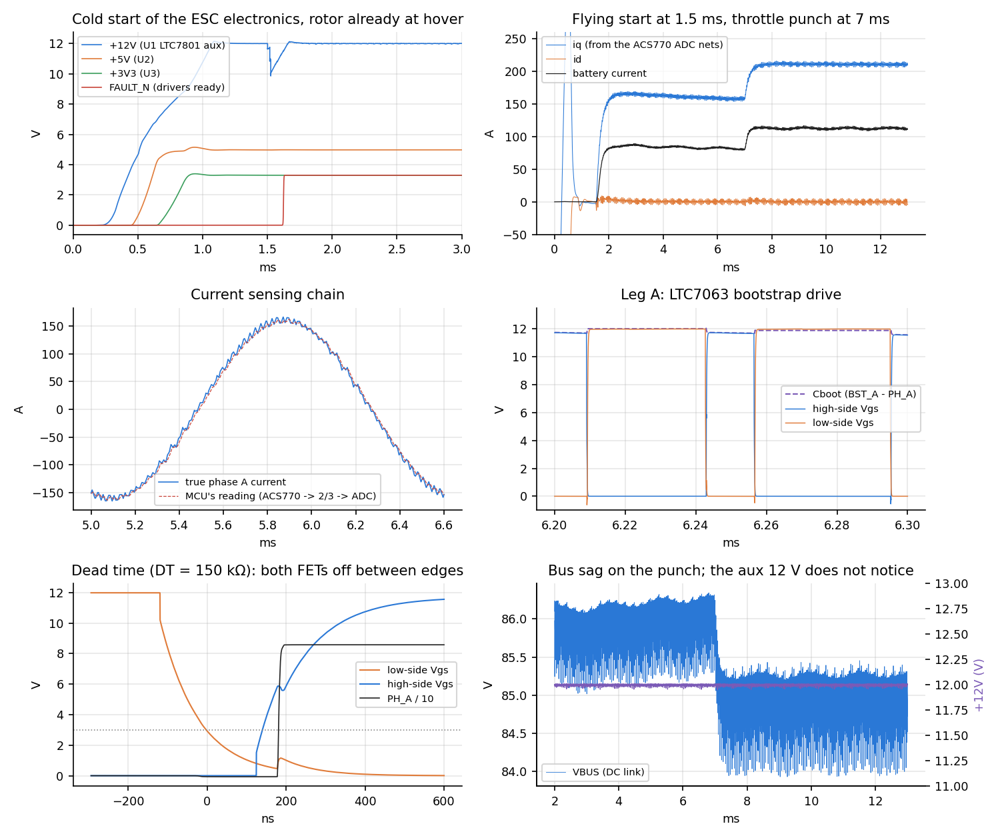

# 10 — Hardware Schematics: ESC Board and Avionics Power Board

**Topology type:** topology 09 turned into two real PCBs with real parts. Each board is one LTspice schematic you can run, plus a BOM and a net list you can redraw in KiCad.

| Board | Qty per aircraft | What it does |
|---|---|---|
| **ESC board** (`ESC_Board.asc`) | 3 (one per motor) | 24S DC link → 3 × LTC7063 gate drivers → 24 × IPB065N15N3 (4 in parallel per switch) → U15XL. It has its own LTC7801 12 V aux supply, LT1763 5 V / 3.3 V, two ACS772 ±250 A current sensors and an STM32G431 running FOC. |
| **Avionics power board** (`Avionics_Board.asc`) | 1 | Three 24S packs → fuses + diode-OR → TVS + LTC4366 surge stopper (115 V) → LTC7801 12 V / 5 A (transmitter) → LT8641 5 V / 3 A (flight controller + receiver) → LT3045 3.3 V / 0.3 A (sensors). |

**Builds on:** [09](../09_24S_FOC_Drive_Low-Voltage_Rails/README.md) (the design these boards implement), [03](../03_Three-Phase_FOC_PMSM/README.md) (FOC), [06](../06_BEC_Synchronous_Buck_5V/README.md) (buck design), [08](../08_Redundant_Avionics_Power/README.md) (avionics fed from all three packs).
**Design document (with all the math):** `10_Hardware_Schematics_ESC_Avionics_Design.pdf`

## Files
| File | What it is |
|---|---|
| `board.py` | Builder: one parts table → `.asc` + BOM + net list (they can't drift apart) |
| `hand_calc.py` | All predictions (`python3 hand_calc.py`, `python3 hand_calc.py esc`) |
| `avionics.py`, `esc.py` | The two boards. `python3 avionics.py loop` also writes the loop-gain test |
| `*_BOM.csv` | Reference, quantity, description, value, part number / specification, **KiCad footprint**, rating |
| `*_Netlist.csv` | Every net with every `REF.pin` on it, the wiring list for KiCad (simulation-only parts removed) |
| `plot_results.py`, `make_design_doc.py` | Plots and the design PDF |
| `kicad_footprints.py`, `kicad_export.py`, `kicad_check.py` | KiCad: footprint library, both projects with PCBs, and the checks (see below) |

## Running the simulations
Open the `.asc` in LTspice and press Run, or in batch:
```bash
wine "$HOME/.wine/drive_c/Program Files/ADI/LTspice/LTspice.exe" -b ESC_Board.asc
```
| Run | Shows | Time |
|---|---|---|
| `Avionics_Board.asc` (8 ms) | Cold start and sequencing, transmitter switch-on, controller load step, pack 1 pulled | ~10 min |
| `Avionics_LoopTest.asc` | 12 V loop gain at 3 / 6 / 12 / 24 kHz by injection, on the switching circuit | ~5 min |
| `Avionics_SurgeTest.asc` (300 ms) | LTC4366 start-up, then pack 1 at 200 V behind 4 Ω for 20 ms: VIN_PROT must stay at 115 V | ~2 s |
| `ESC_Board.asc` (13 ms) | Cold start of the ESC electronics with the rotor at hover, flying start, throttle punch | ~7 min |

Parts named `V_…`, `B_…`, `L_HARN`, `R_CS…`, `R_BW…`, `C_BW…`, `La/Lb/Lc`, `C_J`, `C_TH`, `R_LK…`, `R_VBF`, `C_VBF`, `C_VTX`, `R_SSRUN`, `R_LOAD_SS` are simulation stimulus or models: the packs, the loads, the motor, and the STM32's FOC firmware as a behavioural block. Everything else is a board part with its real reference designator.

## Fixes from the parts-alternatives study
[Alternatives_Study](../Alternatives_Study/README.md) checked each section against datasheet ratings. Three problems are fixed here:
| Problem | Fix | Check |
|---|---|---|
| DC-link ripple 61.7 A rms at hover over 16 caps = 3.86 A each, above the 3.5 A rating | C65–C72: 8 more 150 µF 125 V hybrid polymer, 24 in all → 2.57 A each (3.48 A at punch, seconds only) | `python3 hand_calc.py changes`; ESC run `Icap_bulk` |
| Punch needs iq = 210 A; ACS770LCB-200B is specified to ±200 A | U7, U8 → ACS772ECB-250B: ±250 A, 8 mV/A, 200 kHz, same CB package and pinout. ADC still fits ±306 A, 151 mA/LSB | ESC run (firmware block uses 8 mV/A) |
| SMBJ110A clamps to 177 V at 3.4 A; the LTC7801 is rated to 150 V | U4 LTC4366-2 surge stopper + Q4 FDB33N25 (250 V): VIN_PROT held at VREG = 1.23 V (1 + R24/R23) = 115.3 V, 51 ms timer, 9 s cool-down | `Avionics_SurgeTest.asc`: 179 V in → 115.5 V out (hand 115.3 V) |

The LTC4366 takes ~0.1 s to turn Q4 on, so the 8 ms board run models Q4 already on (sim-only `R_SSRUN`, 94 mΩ), and its packs
ramp up from 0 V in 0.2 ms (the LTC4366 model has no DC operating point with the packs already at 88.8 V).

## Whole power system
The whole system, with both boards drawn part by part and wired to three packs and three motors, is now topology
[11](../11_Whole_System_Schematic/README.md) (`Power_System.asc`, the drawn board sheets and the KiCad entry guide).
The block diagram of everything, with part numbers, is in [System_Flowchart](../System_Flowchart/README.md).

## KiCad projects (both boards): schematic, footprints and PCB
```bash
python3 kicad_export.py all     # footprint library + both projects + overview plots
python3 kicad_check.py          # ERC, net list vs parts table, footprints, schematic-PCB parity (KiCad itself)
```
| Folder | What it is |
|---|---|
| `kicad/Drone_Power.pretty/` | **Every footprint both boards use (39).** 35 are KiCad 9 stock footprints, copied in under their KiCad names (`kicad_footprints.py`). 4 are not in KiCad's library and are generated from the manufacturers' drawings (table below) |
| `kicad/ESC_Board/` | Schematic (197 parts), `ESC_Board.kicad_pcb` with all 197 footprints loaded and every pad on its net, `fp-lib-table` / `sym-lib-table` |
| `kicad/Avionics_Board/` | The same for the avionics board (77 parts) |
| `kicad/*_footprints.png` | KiCad's plot of each imported PCB: footprints parked by schematic block, ready for placement |

The PCBs are what **Tools → Update PCB from Schematic** would give: each footprint is linked to its symbol (same UUID path),
the nets come from KiCad's own net list of the schematic, and attributes (DNP, BOM) follow the symbols. There is no board
outline yet; draw it on Edge.Cuts, then place and route. The only DRC error today is that missing outline.

| Generated footprint | Part | Source |
|---|---|---|
| `Linear_UDC-18-2EP_3x4mm_P0.5mm` | LT8641 (avionics U2) | LT8641 datasheet Rev B: UDC 20(18)-lead QFN 3 × 4 mm, DWG 05-08-1956 Rev C. 0.25 × 0.70 mm lands at 0.5 mm, pins 5 and 12 removed, two exposed SW pads (21: 0.22 × 0.40 mm, 22: 0.22 × 0.356 mm) |
| `Linear_HTSSOP-24-1EP_4.4x7.8mm_P0.65mm_EP2.74x3.25mm` | LTC7801 (U1, both boards) | LTC DWG 05-08-1771 Rev B, FE24 exposed pad variation AA: 0.45 × 1.05 mm lands, exposed pad 2.74 × 3.25 mm = GND, 2 × 2 paste windows |
| `AMASS_AS150_Pigtail_2x8AWG_P15mm` | J1, ESC battery input | The AS150's two 8 AWG pigtail leads: 5.1 mm drill, 8.4 mm pads, 15 mm pitch (6.6 mm copper gap on the 100 V bus). Pad 1 = +, pad 2 = − |
| `SolderWire-8AWG_1x01_D4.2mm_OD7mm` | J2–J4, motor phase leads | 8 AWG silicone lead (4.2 mm conductor): KiCad's wire-pad rule, drill = conductor + 0.9 mm |

**Checked** (`kicad_check.py`): ERC 0 errors / 0 warnings on both boards; KiCad's net list equals the parts table on all
92 + 40 nets; every symbol pin has a pad of the same number; schematic-PCB parity 0 issues; polarised capacitors have pad 1
(+) off ground. Pads without a net are only unused MCU pins, the LTC7063 NC pins, TC2030 pad 6 (SWO) and connector
mounting tabs. Re-running the export gives identical files (UUIDs are derived from the board name).

**Corrected while importing the footprints**
- The LTC7801 had been given an HTSSOP-24 footprint whose 3.2 × 5 mm exposed pad comes from an ST drawing; ADI's FE24 pad is
  2.74 × 3.25 mm, so that land would have printed about 1.8× too much solder paste under the chip.
- The LT8641 is in ADI's UDC QFN (LT8641EUDC#PBF), not an LQFN: the BOM part number and package are fixed.
- J7 (Tag-Connect TC2030) had SWCLK and NRST swapped against the TC2030-CTX cable (pads 1 VCC, 2 SWDIO, 3 nRESET, 4 SWCLK,
  5 GND): now NRST is pad 3 and SWCLK pad 4.
- The motor phase pads were KiCad's 2.5 mm² wire pad, far too small for the 6–8 AWG phase leads; now 8 AWG pads.
- SMBJ110A is unidirectional, so it uses `Device:D_Zener` (K = 1, A = 2) instead of the bidirectional `D_TVS`; fuses use `Device:Fuse`.

## Porting to KiCad by hand
1. **One schematic per board**, with one hierarchical sheet per numbered block (the framed areas in the `.asc`): e.g. ESC = 1 power input, 2 aux supply, 3 logic supplies, 4–6 legs A/B/C, 7 current sense, 8 MCU and connectors. Use global labels for the nets that cross sheets (`VBUS`, `+12V`, `+5V`, `+3V3`, `PWM_A`…).
2. **Symbols.** KiCad's stock library has the STM32G431CBTx, the ACS770/ACS772 CB-package symbol, the LT3045 and the AS5047. The **LTC7801, LTC7063, LT8641, LT1763 and LTC4366 are not in KiCad's library**: use the generated ones in `kicad/<Board>/<Board>_custom.kicad_sym`. Pin names in the net list are LTspice's names (`SENSE+`, `BGRTN`, `_FLT` = FLT-bar, `_SHDN` = SHDN-bar); match them to the datasheet pin names, not to pin numbers.
3. **Wire from `*_Netlist.csv`**: each row is one net and every pin on it. Parts listed with a quantity (e.g. `Q4 Q5 Q6 Q7`) are parallel copies with identical connections.
4. **Footprints** are all in `kicad/Drone_Power.pretty` (add it to your footprint library table). The BOM gives each one by its KiCad library name; the four `Drone_Power:` ones are generated from the manufacturers' drawings.
5. **The MCU pin map is a proposal.** TIM1 CH1–3 on PA8–PA10 for the gate drivers, ADC1 on PA0–PA3, SPI1 on PA4–PA7 for the encoder, SWD on PA13/PA14. Check every alternate function in STM32CubeMX before you route.

## Layout rules that the schematic can't show
- **Power loop first.** Per leg, the loop from the DC-link ceramics (C17–C26) through the high-side and low-side FETs must be as small as possible. Put the ceramics right across each leg, with the polymer capacitors next to them.
- **Current.** 110 A punch, 74 A hover: use 3 oz copper or bus bars on VBUS, GND and the phases. The motor leads need about 6–8 AWG.
- **100 V spacing.** Keep at least 0.6 mm clearance between 100 V nets and logic. Keep the bootstrap nodes (`BST_x`, `PH_x`) away from the MCU.
- **Gate drive.** Each LTC7063 goes next to its leg. Route TG with its return SW (and BG with BGRTN) as tight pairs, put one gate resistor at each FET, and place the bootstrap diode and capacitor at the driver.
- **Grounds.** Power ground (FET sources, DC link) and signal ground (MCU, ADC dividers, LDOs) join at one point near the DC-link negative. The ACS772 is isolated, so its output side belongs to signal ground.
- **Sense lines.** Use a Kelvin connection on R1 / R7 (current sense) to SENSE+ / SENSE−, and route the ADC lines (ISNS_x, VBUS_SNS) as guarded traces away from the switch nodes.
- **Thermal.** About 70 W of FET loss at hover, so the 24 D2PAKs need a heatsink. The NTC (R6) goes on it.

## Results (hand → LTspice)
**Avionics board**
| | Hand | LTspice |
|---|---|---|
| +12V / +5V / +3V3 (V) | 12.000 / 4.988 / 3.320 | 11.995 / 5.046 / 3.282 |
| 12 V loop: crossover / phase margin | 11.57 kHz / 49.8° | 10.59 kHz / 53.0° (transient injection) |
| Current per pack, all three connected (A) | 0.112 | 0.114 |
| Packs 2 and 3 after pack 1 is pulled (A) | 0.167 | 0.170 (12 V moves 20 mV) |
| Transmitter switch-on: 12 V dip (mV) | 198 | 222 |
| 12 V stage / whole board efficiency | 97.9 % / 93.8 % | 95.2 % / 91.2 % (input now includes the LTC4366 stage, ≈ 45 mW in its resistors) |

**ESC board** (hand evaluated at the operating point LTspice reached: iq = 160.4 A, ω = 190.7 rad/s)
| | Hand | LTspice |
|---|---|---|
| Cold start: 12 V up / drivers enabled | 0.72 ms + delay / 1.5 ms (MCU) | 1.00 ms / FAULT_N high at ~1.6 ms |
| +12V minimum at driver enable (V) | 11.0 (charge sharing) | 9.86 |
| iq read by the MCU vs. true (A) | 160.4 | 159.6 (-0.5 %) |
| ESC input = electromagnetic + copper + inverter (W) | 6660 + 328 + 97 | 7102 = 6660 + 329 + 105 |
| Dead time at Vgs = 3 V (DT = 150 kΩ) | — | 142 / 141 ns |
| Bootstrap current, 3 legs (mA) | 25.3 | 24.4 |
| Bootstrap voltage (V) | 12 − Vf − Qg/C | 11.04–12.12 |
| Punch: iq / ESC current (A) | 210 | 210.5 / 112.3 |




## What went wrong first
1. **Units.** The `.asc` files were first written as UTF-8 with `µ`. LTspice read it as two Latin-1 characters and dropped the unit: 47µ became 47 H and nothing started. `board.py` now writes `u` in Latin-1.
2. **Library models looked missing** from a bare `.cir` test. LTspice loads its standard libraries only for `.asc` files. Confirm a model by measuring it (Ron with 1 V / 1 mΩ), not by the absence of an error.
3. **`aux.asc` cannot be opened under Wine**: AUX is a reserved DOS device name.
4. **Net-name collision**: the aux supply's gate nets were `TG_A` / `BG_A`, the same as leg A's. Two gate drivers drove each other's FETs and +12V reached 45 V. In a net-label schematic the names are the wiring, so the aux nets are now `_AUX`.
5. **Constant-current loads** dragged rails negative at start-up and broke the LDO models. Every load now scales with limit(V/Vnom, 0, 1).
6. **`.ic` on an encrypted controller** (soft-start pin, output rail) gave impossible operating points (29 A in L1 at t = 0). The electronics now start cold, and only the rotor speed is preset.
7. **Missing parts the simulation found**: gate-source pull-downs (high-side FETs drifted on through Cgd while the drivers were unpowered), the LT1763 bypass capacitors (they slow start-up by several ms; now do-not-fit), and 12 V bulk (driver enable dipped +12V to 7.4 V; a 47 µF fixes it).
8. **Burst Mode** on the avionics 12 V gave a 90 mV, 25 kHz sawtooth at light load, so MODE is tied to INTVCC (forced continuous).
9. **The sensor model lied**: a 1 kΩ bandwidth resistor in the ACS770 model lost 3 % into the ADC divider (now 10 Ω + 133 nF).
10. **"Efficiency" of 76.6 %** was the rotor still accelerating after the coast (649–867 W into ½Jω²). The energy balance closes once that is counted.
11. **`ltraw.read_meas`** returned the threshold of WHEN measurements instead of the time. Fixed for every topology.

## Assumptions to replace with measurements
Inherited from 09: motor Lph 25 µH, 21 pole pairs, rotor inertia 0.15 kg·m², pack resistance 30 mΩ, and the avionics currents. New here: the LTC7801's ITH gain (assumed 1/12, measured ≈ 1/13), the supply currents of the STM32 / ACS772 / AS5047, and the derated capacitances of the ceramics at their bias voltage.
